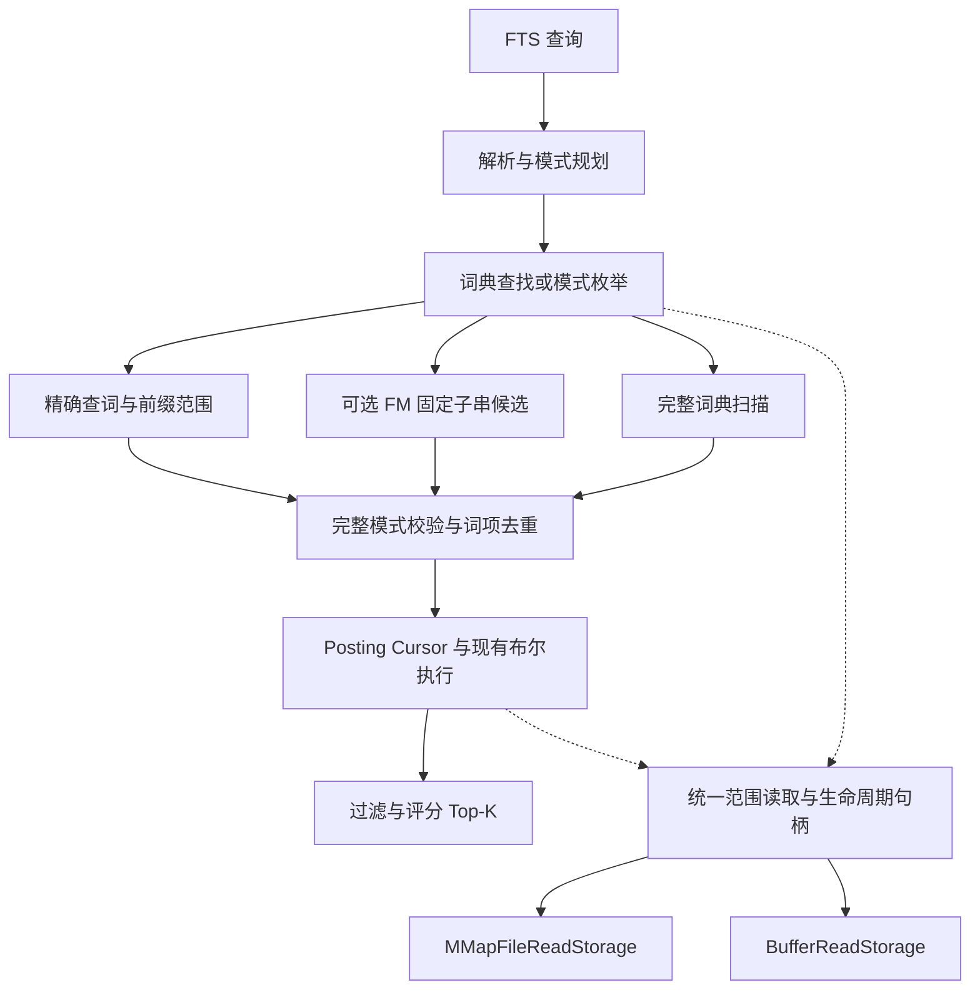

# FTS 自定义索引与词项模式检索设计

设计日期：2026-11-17。

本方案整合紧凑倒排格式、mmap 与 buffer pool 双读取模式、词项 wildcard/regex、FM-index 词典加速、构建合并及兼容迁移。状态为待实施设计；文件名、接口名和参数名表示拟议契约。

## 1 设计决策

采用“可写段暂留 RocksDB，冻结段使用专用倒排容器，FM-index 作为可选词典辅助索引”的架构。主格式的空间优化与模式查询功能独立于 FM 是否存在。

| 事项 | 第一版决定 |
|---|---|
| 优化对象 | positions 小 KV、重复 doclen、短 posting 元数据，以及完整 term value 的读取粒度 |
| 读取模式 | 严格沿用 DB 创建时的 enable_mmap；重开使用持久化模式 |
| 主索引 | 每个 FTS block 一个不可变容器，多字段分 section |
| 读取后端 | mmap 与 buffer pool 同期支持，使用同一磁盘编码 |
| 可写索引 | 首期保留 RocksDB；内存倒排另行演进 |
| DocLen | 每文档每字段存一次精确长度；不默认量化 |
| 模式匹配对象 | 分词及过滤后的最终词项，整词匹配 |
| wildcard | * 匹配零或多个 Unicode 标量值，? 匹配恰好一个 |
| regex | 有资源限制的正规表达式子集，不支持反向引用、环视等扩展 |
| FM 的作用 | 从去重词典中寻找固定子串，返回候选 termOrdinal |
| 最终匹配 | 对候选词项执行完整 wildcard/regex 校验，再打开 postings |
| 无 FM 的行为 | 相同语义的前缀枚举或词典扫描；不漏掉可写段、旧段 |
| 默认模式评分 | 每个模式子句 constant score；可显式选择 BM25 扩词计分 |
| 迁移 | 旧新 reader 混读，新增明确的格式转换任务 |
| 超限 | 返回明确错误，不截断扩词，不返回部分 Top-K |

本方案不覆盖原文字段的跨词 regex、SQL LIKE 的替换、短语内的模式占位符、全局 BM25 统计改造和动态 BWT。用户确认的模式语义是“匹配词项，再召回包含这些词项的文档”。

## 2 当前实现与优化依据

冻结后的 posting 已包含 128-doc BitPacked block、docID 差分、TF/doclen、SIMD 解码、skip 和 Block-Max。其问题不是缺少倒排压缩，而是编码布局与 RocksDB 的访问粒度仍有额外成本。

| 当前路径 | 优化方向 |
|---|---|
| term → 一整个 BitPacked value | 改为目录定位和按块范围读取，避免先取得完整高频词 posting |
| (term, docID) → positions 小 KV | 连续位置流，消除重复键，并支持有界随机定位 |
| 每个 posting 内联 doclen | 独立精确长度列，减少跨 term 重复 |
| singleton 也有完整块头与对齐 | 内联或短列表专用编码 |
| seal 先写 RocksDB 再转换 posting | 新段直接从可写 CF 生成目标格式 |
| reducer 扫 posting 恢复文档长度统计 | 从独立长度列统计，再流式合并 |

不能从逻辑 KV 字节直接推导最终 SST 大小。当前 block_cache=nullptr 会创建默认缓存；调用的 OptimizeLevelStyleCompaction 也会根据编译支持设置压缩策略。空间、缓存与加速收益必须按实际配置测量，不采用“固定缩小十倍”等承诺。[RocksDB 缓存说明](https://github.com/facebook/rocksdb/wiki/Block-Cache)、[8.1.1 配置实现](https://raw.githubusercontent.com/facebook/rocksdb/v8.1.1/options/options.cc)。

主要源码入口：

- [FTS 写入与查询](/Users/jiliang.ljl/Project/vector/zvec/src/db/index/column/fts_column/fts_column_indexer.cc:606)
- [现有 posting 格式](/Users/jiliang.ljl/Project/vector/zvec/src/db/index/column/fts_column/posting/bitpacked_posting_list.h:30)
- [现有 FTS reducer](/Users/jiliang.ljl/Project/vector/zvec/src/db/index/column/fts_column/fts_rocksdb_reducer.cc:232)
- [段 flush 与 seal](/Users/jiliang.ljl/Project/vector/zvec/src/db/index/segment/segment.cc:2154)

## 3 架构与模块接口



保留现有 AST、AND/OR、候选集、删除过滤和短语两阶段执行。在词典、posting cursor、位置读取和底层范围读取处建立接口，不在每个调用者内判断文件格式或读取模式。

| 模块接口 | 必要能力与契约 |
|---|---|
| FtsSegmentReader | 绑定一个已发布 generation；提供字段词典、精确长度、统计和 posting |
| TermDictionaryReader | lookup、seek_prefix、有序遍历、按 ordinal 获取词条与 TermInfo |
| PostingCursor | next、advance、TF、当前位置列表、块范围及安全上界；DocID 单调递增 |
| PatternPlanner | 编译一次模式，选择候选路径，产生不遗漏的词项集合 |
| TermFmReader | search_literal 返回区间及 occurrence 数；按预算枚举 termOrdinal |
| FtsSegmentWriter | 顺序追加排序词项与 posting；完成后输出可校验的不可变文件 |
| FtsReducer | 新旧源 reader 混合输入，统一 DocID 重映射，输出新格式 |
| QueryBudget | 在整个查询、所有字段和段之间累计编译、枚举、读取及内存成本 |

TermInfo 包括 df、total_tf、编码类型、posting/skip/positions 的逻辑偏移及长度。新格式 termOrdinal 仅在指定字段词典 generation 内稳定；旧 RocksDB adapter 可使用词项字节作为身份，不要求伪造持久 ordinal。

读取结果必须区分“词不存在”和 I/O、损坏、未知版本、资源超限。若迭代接口保留返回 DocID 的形式，内部累积 Status，并由 search 在返回结果前检查；错误不得转换成 NO_MORE_DOCS 后静默成功。

advance 只负责定位，不擅自执行会遗漏 SHOULD 计分贡献的剪枝。解码缓冲属于 cursor，底层 reader 可跨查询共享。

## 4 双读取模式与物理容器

### 4.1 模式来源

DB 创建时将 enable_mmap 写入版本，重开时恢复该值，随后传给 SegmentOptions。FTS 基础文件和 FM 辅助文件必须使用相同来源的模式；不增加独立的 FTS mmap 开关。

- enable_mmap=true：MMapFileReadStorage。
- enable_mmap=false：BufferReadStorage，不映射整个 FTS/FM 文件作为替代实现。

依据：[创建时保存模式](/Users/jiliang.ljl/Project/vector/zvec/src/db/collection.cc:2506)、[恢复模式](/Users/jiliang.ljl/Project/vector/zvec/src/db/collection.cc:2298)。

### 4.2 复用现有容器

外层优先使用 FileDumper / IndexPacker 容器，两种读取后端都能通过 IndexUnpacker 打开。FTS 自定义头放在 fts.meta section，FM 头放在 fm.meta section；不能自行写一个不兼容的裸 ZFTS 头，再交给现有 storage 打开。

拟议文件：

```text
fts.<block_id>.zfts
  fts.meta
  field.<ordinal>.terms
  field.<ordinal>.term_index
  field.<ordinal>.term_meta
  field.<ordinal>.doclen
  field.<ordinal>.presence
  field.<ordinal>.postings
  field.<ordinal>.skips
  field.<ordinal>.positions
  field.<ordinal>.position_index
  checksums

fts.<block_id>.<fm_generation>.zftm
  fm.meta
  field.<ordinal>.fm_config
  field.<ordinal>.fm_levels
  field.<ordinal>.fm_rank
  field.<ordinal>.sa_sample_marks
  field.<ordinal>.sa_samples
  field.<ordinal>.term_boundaries
  checksums
```

每个 FTS block 最多关联一个当前 FM 辅助容器；内部可只包含启用 FM 的字段。page 是 section 内的逻辑范围，不创建“每 term/每 page 一个文件或一个外层 section”。

FTS/FM codec 版本独立于外层容器版本。内层明确 little-endian、定宽整数、64-bit 文件偏移及长度，拒绝未知必需特性；不得直接 memcpy C++ struct 作为格式规范。外层容器自身的字节序和版本限制也须纳入跨平台验证。

### 4.3 范围读取与内存

复用 IndexStorage 的 MemoryBlock/ScatterBlock 生命周期语义。调用者只有在句柄有效时才能访问返回地址；mmap 也必须持有 reader generation，不能提前主动 close 底层映射。

buffer pool 单页可直接 pin，跨页可返回多个 span，或将一个有界 codec 块复制到 scratch。不能一次读取整条 posting、整个 BWT 或全部 doclen，再称为分页实现。缓存不足时允许受预算控制的 bypass 读取，不依赖无限 pin。

128-doc 是解码块，不是磁盘读取页。多个解码块共用读取页；codec 块是否跨页由范围读取层处理。词典顶层索引、FM C 表等小结构可驻留，但占用必须计入预算；完整 skip、rank、doclen 不预设常驻。

缓存键包含不可变文件 generation、字段/section 和页号。新 generation 使用新路径与新 storage handle，禁止原地覆盖。

既有能力：[MemoryBlock 与 ScatterBlock](/Users/jiliang.ljl/Project/vector/zvec/src/include/zvec/core/framework/index_storage.h:391)、[BufferReadStorage](/Users/jiliang.ljl/Project/vector/zvec/src/core/utility/buffer_read_storage.cc:85)。

## 5 基础 FTS 格式

### 5.1 字段元数据和词典

fts.meta 保存格式版本、block generation、字段目录、DocID 范围约束、统计语义版本及各 section 引用。每字段记录：

- segment_row_count、field_present_count、scoring_document_count、total_tokens 和 statistics_policy。
- dictionary_generation、term_count、dict_fingerprint。
- tokenizer/filter 配置标识及词项编码版本。
- posting、长度、位置和 skip 的 codec 标识。
- 固定评分参数及上界有效性标识。

dict_fingerprint 对“按 ordinal 排序、带长度边界的最终 term 字节序列”计算强摘要。它绑定逻辑词典及 ordinal 映射；物理块校验另行保存。

词典按最终 term 的 UTF-8 字节序排序。第一版使用前缀压缩块及稀疏首词索引，块内初始可取 64 个 term，另设字节上限处理超长词。TermMeta 采用分块可寻址布局，ordinal lookup 只解码对应元数据块，不扫描整个词典。

精确查词定位一个词典块；前缀枚举从 lower_bound(prefix) 开始，直到不再 starts_with(prefix)。不依赖未经溢出检查的“最后一字节加一”构造上界。

### 5.2 Posting 分层编码

| 情况 | 编码 |
|---|---|
| df=1 | 在 TermMeta 内联 varint DocID 和 TF；位置可另引用 |
| 短列表 | 紧凑 varint 或小块 bitpack，省略完整 skip 和尾部对齐 |
| 长列表 | 128-doc 块，DocID 差分与 TF 分流，skip 按块定位 |

编码选择按实际字节数和解码成本确定，不把 df<128 固定为唯一选择条件。inline 的有限位宽实现必须带 escape/fallback，不能把现有 TF 默默截断到 16 bit。

每块单独记录首 DocID，其余保存相邻差分；块首差分置零，不让无用绝对值或跨块 gap 抬高位宽。TF 编码 tf-1；全为 1 时可省略 TF 数据。首版保留现有 SIMD 基础与 scalar fallback，不预设所有平台都有同一 SIMD 路径。

长 posting 的 skip 可分两级，目录本身按页读取，不在 open 时扫描所有块计算上界。词级上界写入 TermMeta，块上界写入 skip，避免重复保存。

### 5.3 精确文档长度和字段存在性

第一版按 segment-local row ID 存 uint32 doclen，每百万行每字段约 4 MB；后续可替换为无损分块编码。字段缺失时填零但 presence=false；显式空文本或过滤后无 token 时 presence=true、doclen=0。

不能按“本字段收到的文档次数”简单 push_back 后当作 local DocID 数组，因为可空字段收到的 ID 可能为 0、2、5。

第一版不采用一字节 SmallFloat 作为唯一长度来源。有损长度既可能改变 BM25，也无法精确恢复删除后的 total_tokens。长度去重与量化是两个独立决策。

历史 reducer 对缺字段计数存在统计口径差异。第一版将真实 field_present_count 与评分使用的 scoring_document_count 分开，默认 statistics_policy=legacy_compatible：

- 纯格式转换原样保留源段评分计数，不改变现有 N/avgdl。
- 对历史冻结段，从 posting 恢复每行精确 doclen；从 forward 读取字段是否存在，不重分词。没有 posting 的行长度为零，但仍由 forward 区分空文本和缺字段。
- 若无法取得恢复 presence 所需的 forward 数据，转换必须明确失败并保留旧 reader，不能猜测字段存在性。
- 普通合并维持现有 reducer 的评分计数口径，包括其使用目标物理行数计算 N 的 legacy 行为；同时另存真实字段存在计数。total_tokens 从精确长度按相同删除规则计算。
- 将合并后的 N 改成字段存在数属于单独的 field_present_v1 统计升级，需显式重建和验证。不同统计策略不得无声明地混合合并。

新格式保存真实字段信息，是为后续正确升级提供条件；它本身不授权修改历史评分语义。

### 5.4 Positions 与随机定位

按 term、posting 顺序连续存储文档内 delta-varint positions，文档边界由 TF 和定位结构解释。普通 BM25 查询不读位置。

每个 posting block 记录位置起点，块内每 16/32 文档初始配置一个字节偏移检查点。为保证最坏读取量，还需按位置数量或字节数切分大列表；超长单文档使用子块目录。仅按文档数设置检查点不足以约束高 TF 情况。

TF 前缀和给出位置序号，不给出 varint 字节偏移。reader 应使用检查点和受限扫描定位，不能承诺常数时间跳过任意数量位置。

首版采用文档独立编码，已知字节边界时可在合并中复制未改变的文档位置切片。若后续引入跨文档 SIMD position block，删除和重新分块时允许解码重编码；只对完整且边界兼容的块启用复制快路径。

### 5.5 评分与安全剪枝

普通词项保持现有段级 BM25 语义，不同时改为全局统计。查询固定统计快照；可缓存归一化系数，但浮点运算顺序变化要独立验证。

新格式支持上界编码类型。第一版可保存固定统计下保守 FP32 块上界，同时存参数/统计身份；若身份变化必须重算或使用安全退化上界。不得普通舍入到 FP16 后直接剪枝。

maxTF/minDL 或非支配 (TF,doclen) 对作为后续候选。前者安全但可能更松，后者增加元数据与计算；根据跳块率和总查询成本选择。所有上界须覆盖 boost，发生量化时向保守方向处理。

## 6 Wildcard 和 regex 的产品语义

### 6.1 匹配最终词项

模式匹配完整的最终索引词项：

| 表达式 | 含义 |
|---|---|
| wildcard("data*") | 词项以 data 开头 |
| wildcard("*base") | 词项以 base 结尾 |
| wildcard("*data*") | 词项包含 data |
| wildcard("d?ta") | 中间恰好一个 Unicode 标量值 |
| regex("dat[a-z]+") | 整个词项符合该正规表达式 |
| regex("data") | 只匹配词项 data |
| regex(".*data.*") | 词项包含 data |

模式默认大小写敏感，直接作用于最终词项，不再执行 tokenizer、stemmer 或停用词过滤。字段配置 lowercase 时，模式通常也需要小写；running 被索引为 run 后，regex("running") 不匹配 run。

不要把整个 regex/wildcard 送入现有分词流水线。后续若提供自动大小写或 folding，需要专门的 multi-term normalizer，并证明候选筛选与最终 verifier 使用一致变换；第一版不隐式引入它。

FM 按 UTF-8 字节工作，最终 wildcard 的 ? 与 regex 字符类按 Unicode 标量值工作，不按字节或字素簇计数。拒绝无效 UTF-8 模式；无效索引词项要在构建或迁移时明确处理，不能静默从 FM 丢弃。

wildcard 的 * 可以匹配零个字符，但没有空词项时 wildcard("*") 只命中有至少一个索引词项的文档，不等于所有文档。regex("") 同样只匹配空词项，不把“空模式”解释为全库。

### 6.2 语法与兼容

第一版采用显式 wildcard("...")、regex("...") 函数形式，保留模式节点边界。裸 data*、*base 作为后续语法糖；不直接引入 /regex/，因为现有 TERM 已允许 /。

新增 query_string_syntax=legacy|pattern_v1，默认 legacy；pattern_v1 才解释模式函数，避免已有自然词序列被重新解释。match_string 继续是自然语言分析入口，不识别模式操作符。

函数名只在调用位置识别，普通单词 wildcard 和 regex 仍可检索。引号外层转义与模式层转义分开解析：外层只接受 `\"` 和 `\\`，分别还原引号和反斜线，其他未定义外层 escape 报错；模式引擎随后解释保留下来的转义。不能复用现有“删除所有转义反斜线”的 unescape。

以下是原始 FTS 查询文本，SDK 语言的字符串转义还需在其外层单独处理：

```text
regex("\\.")       匹配字面量点号
regex("\\d+")      匹配数字词项
wildcard("\\*")    匹配字面量星号
regex("\d+")       外层出现未定义转义，返回参数错误
```

当前 parser 虽有 field: 和 ^boost 的语法分支，执行层明确拒绝它们。第一版保持该限制，不因引入模式而顺带开放；AST 内部已有 boost 仍需正确传递。

修改 FtsLexer.g4 / FtsParser.g4 后运行本模块 gen_parser.sh，不能手工改生成代码。[现有解析入口](/Users/jiliang.ljl/Project/vector/zvec/src/db/index/column/fts_column/parser/fts_query_parser.cc:77)。

### 6.3 Regex 子集与执行器

第一版支持字面量、连接、选择、分组、字符类及否定类、点号、?、*、+ 和受限重复次数。可支持明确列出的 Unicode 类。整词匹配使用 FullMatch 语义；regex 点号默认不含换行，与最终 matcher 的配置保持一致。wildcard 的 * 和 ? 则覆盖任意 Unicode 标量值，包括换行；若内部将 wildcard 编译为 regex，必须使用相应的全字符转换，不能直接套用默认点号。

不支持反向引用、环视、递归、嵌入 flags 和需要回溯语义的扩展。不做捕获结果返回。语法不支持时明确报错，不将其作为普通文字。

执行器接口封装编译、FullMatch、预算和错误。首选评估 RE2 固定版本作为实现及测试基准，使用有内存限制的执行方式；不使用无预算的 std::regex 回溯实现。依赖选择还需检查构建依赖、许可、Windows/iOS/Android 支持。RE2 的能力边界见[官方说明](https://github.com/google/re2)、[语法](https://github.com/google/re2/wiki/Syntax)。

### 6.4 布尔组合和评分

PatternNode 是一个原子查询子句：

- +wildcard("data*") 表示至少命中一个展开词，不是要求命中所有展开词。
- a NOT regex("temp.*") 从 a 的命中集合排除模式命中文档。
- 两个模式的 AND 可由文档中的两个不同词项分别满足。
- SHOULD 模式不改变已建立的 MUST 命中集合，只提供其计分贡献。
- 没有正向基集的全否定查询继续遵循现有拒绝/空集契约。
- 第一版不支持在引号短语内嵌入 wildcard/regex；普通短语行为不变。

默认 constant_score：一个模式子句对一个文档最多贡献一次 1.0 乘内部 boost，与匹配了多少扩展词无关。模式内候选词必须去重；不同逻辑模式仍是不同子句，可共享物理读取但不能盲目合并计分。

显式 pattern_score=scoring_boolean 时，同一模式中的不同展开词各按现有 BM25 求和，同一词只计一次；其结果等价于该模式的完整 OR 扩展。扩展数量受到预算限制，但不使用 TopTerms 截断作为精确结果。

constant_score 的模式上界为该子句权重，不是所有展开词上界之和。作为 NOT 时不计分。PatternIterator 使用只枚举 DocID 的 union，或明确禁用其子迭代器的 BM25 competitive-score 剪枝；不能把父 collector 的分数阈值透传给底层词项，否则实际模式得分为 1 的文档可能因词项 BM25 小于阈值而被错删。块上界同样返回该模式的安全权重，而不是子词的 BM25 上界。

含模式的新查询规定同分按 global DocID 升序。段内 collector 和跨段归并均按“分数降序、global DocID 升序”比较；仅在 upper_bound < kth.score 时可直接按分数剪枝。等于阈值时，除非还能证明该范围中的 DocID 不可能赢得同分比较，否则必须继续检查。

把固定模式优化为 exact lookup，或把前缀模式优化为 range，只改变候选获取方式，不改变 PatternNode 的计分契约。例如 regex("data") 默认仍是 constant_score，不能直接改写成 BM25 TermNode。

## 7 词典层 FM-index

### 7.1 为什么只索引词典

每字段、每个不可变 block 对去重的最终词项构建 FM。基础词典继续服务精确查找、前缀枚举、词项恢复和合并；FM 只加速固定子串候选查找。

其规模由词表总字节数决定，而不是所有文档的 token 数或原文大小。FM locate 的结果映射到 termOrdinal，再访问 TermInfo/postings；它不是文档 DocID。

FM 是额外的辅助空间，不能把已有前缀词典从总账中扣掉。模式功能在 FM 关闭或未就绪时仍完整可用。

### 7.2 词典文本和边界

设去重词项按字节序为 t0 到 t(V-1)，构造：

```text
T = encode(t0) SEP encode(t1) SEP ... encode(t(V-1)) SEP END
M = sum(byte_length(ti)) + V + 1
END = 0
SEP = 1
encode(input_byte) = input_byte + 2
alphabet = 0 ... 257
```

END 是唯一终止符，SEP 是词边界。构建器必须支持该扩展字母表，不能把 257 截断为 uint8。查询字面量不能包含内部 SEP/END，因此不会跨词产生假匹配。空词典不构建 FM，直接返回空枚举。

第一版保存 V+1 个 uint64 起始偏移：前 V 个指向各 term 首符号，最后一个指向 END。由于每词后有一个 SEP，term_length[i]=start[i+1]-start[i]-1，无需另存独立长度数组。locate 得到位置 p 后找到所属 term，并验证 p 落在 term 内，排除 SEP/END。空词典不访问边界数组。后续可评估等价的边界 bitmap/rank 或单调压缩。

### 7.3 Count Locate 和去重

对确定字面量 P，半开 SA 区间的 backward search 为：

```text
l_next = C[c] + rank(c, l)
r_next = C[c] + rank(c, r)
```

从 P 末尾向前迭代。得到的 occ=r-l 是 P 在词典文本中的出现次数，不是不同词项数，更不是文档频率。banana 中 ana 出现两次，但只应返回一个 termOrdinal。

使用按文本位置采样的 suffix array：

```text
sample row i when SA[i] % sample_rate == 0
```

每次 LF 将文本位置减一，因此最多 sample_rate-1 次跳转到样本。不能改成按 SA 行号 i%sample_rate 采样后仍宣称具有这个界。

枚举通过 locate、词边界映射、termOrdinal bitmap/hash 去重完成，并计入 LF 步数、页读取、内存和 deadline 预算。内部接口返回搜索区间，避免 Count 后重新执行 backward search。search_literal 只接收用户字面量字节；另提供 search_suffix 或内部 anchor 参数，由 reader 在内部符号层将 SEP 作为后缀锚点，再反向处理用户字面量。不能把 SEP 当作普通输入字节交给 encode。

近似工作量：

```text
Count       = O(pattern_bytes * rank_cost)
Enumeration = O(occ * sample_rate * LF_cost + occ * boundary_lookup_cost)
```

短高频串可能产生大量重复 occurrence。先 Count 估价；预计 locate 比词典扫描更贵时直接选择扫描。高级 range-distinct/document-array 结构另行评估，不把去重当作免费的常数操作。FM 基础操作可参考[作者说明](https://pages.di.unipi.it/ferragina/Libraries/fmindexV2/index.html)。

### 7.4 分页 rank 格式

第一版生产 reader 必须同时支持 mmap 与 buffer pool。建议采用分页四叉 wavelet matrix，258 符号需 5 层，每层每位置 2 bit：

| 部分 | 内容 |
|---|---|
| FM 配置 | M、V、字母表映射、C 表、层数、采样间隔、codec 与词典身份 |
| 每层数据页 | packed 2-bit symbols，独立长度及 checksum |
| rank 目录 | 页前累计计数、页内小块相对计数，随文件持久化 |
| sampled-row 结构 | 标记 bitmap 及其 rank 目录 |
| SA samples | 被标记行对应的文本位置 |
| term boundaries | 文本位置到 termOrdinal 的定位结构 |

每层只需保存该层四种符号的计数，避免每个小页附带 258 个 64-bit 计数。页大小、页内 checkpoint 间隔和 sample_rate 作为 codec 参数持久化；实验比较采样 16/32/64/128，不先假定最佳值。

提供 RankPair(c,l,r)，同层端点落同页时复用读取；提供融合的 AccessAndRank 支持 LF。跨层仍有数据依赖，不能声称一次 MultiGet 消除所有层间访问。

只读取需要的页与 checkpoint。打开文件读取元数据和顶层目录，不为重建 rank 而扫描全部 BWT。大目录也需分页；低内存模式不能全量 warmup。

固定 5 层的未熵压缩基线，序列化主体可近似估计为：

```text
S_fm ≈ 10*M/8
       + M/8
       + 8*ceil(M/sample_rate)
       + 8*(V+1)
       + rank_directories + headers + checksums
```

依次为 wavelet 数据、sample 标记、64-bit SA 样本、边界数组和元数据。这说明 FM 不保证小于原词典字节数；熵编码或 run-length 只有在实际数据分布支持时才可能进一步节省，必须单独测量。

### 7.5 fm-index-lite 的利用边界

本地已有 [fm-index-lite 集成调研](/Users/jiliang.ljl/Project/vector/zvec/docs/fm-index-lite-integration.md)，原目标是原文 LIKE。本方案改为每个 term 作为一个输入字符串，其返回的输入 ordinal 即词典 termOrdinal。

固定提交 0612c95ca34824f671dabb153ed9ed963b2b106f 可作为构建、算法原型和正确性对照。它支持 LoadView 和拥有连续内存的反序列化，并非只能 mmap；但内部直接解引用连续数组，加载时还会重建 rank 辅助结构，不能原样满足严格分页 buffer pool。

生产集成必须把 rank、locate 和样本读取适配到范围接口，持久化必要目录，补取消/预算和错误传播。不能只在外层添加一个“buffer pool 开关”，内部仍加载完整 FM。上游实现见 [FMIndexInl.h](https://github.com/xiaofan-luan/fm-index-lite/blob/0612c95ca34824f671dabb153ed9ed963b2b106f/src/index/fmindex/FMIndexInl.h) 与 [QuadVector.h](https://github.com/xiaofan-luan/fm-index-lite/blob/0612c95ca34824f671dabb153ed9ed963b2b106f/src/index/fmindex/QuadVector.h)。

采用、适配或替代构建库之前须确认扩展字母表、最大长度、内存峰值、异常转 Status 和各平台支持。SDSL 等实现可作为算法资料，不意味着直接复制其代码或引入其许可依赖。

## 8 模式规划与完整查询路径

### 8.1 路由规则

| 模式形态 | 首选路径 |
|---|---|
| 固定词项 | 词典 exact lookup |
| data* | 词典 prefix range，通常不需要 FM |
| *base | FM 查 base+SEP 并校验；没有 FM 时扫描 |
| *data* | FM 查 data，按 termOrdinal 去重，再校验 |
| data*base | 比较 prefix range 和必要子串候选成本，选较小者 |
| *data*base* | 选择一个选择性较好的必要子串，再校验顺序和间隔 |
| dat[a-z]+ | 由 AST 证明必需前缀 dat，走 prefix range 后校验 |
| (foo\|bar).*baz | 可用所有分支必需的 baz，或构造分支候选并集 |
| [a-z]{3,5}、.* | 无选择性字面量，受预算约束的词典扫描 |

表中 wildcard 形式表示模式参数内容，不表示第一版已经提供裸模式语法。

FM 不直接执行任意 regex。用“自动机状态 × FM 区间”遍历可作为后续研究，但分支和区间数可能很大，不能提供与词表无关的普遍低延迟保证。

### 8.2 必要字面量提取必须保守

候选条件由已解析的正规表达式 AST 推导，不用字符串切割：

- 连接：可选取其中一个已证明必需的子串，或组合多个必要条件。
- 选择 foo|bar：只能使用覆盖全部分支的候选并集，不能只选 foo。
- 可选 (foo)?bar：bar 必需，foo 不必需。
- 重复次数下界为零：不能把其内部字面量当成全局必需条件。
- 无法证明安全的构造：退化为全词典候选。

候选允许多，不允许漏。不同字面量的交集只证明同时出现，不证明顺序、重复次数或锚定条件；最终总是对完整词项做 FullMatch。

候选先以词典身份去重，验证成功后才打开 posting。FM 不能决定字段 DocID、文档删除状态或 BM25 df。

### 8.3 示例

```text
query_string: wildcard("*base") AND regex("dat[a-z]+")

左子句:
  FM 查 "base"+SEP，或扫描词典
  -> 精确验证词项以 base 结尾
  -> 匹配词项 postings 的并集

右子句:
  词典枚举前缀 dat
  -> FullMatch("dat[a-z]+", term)
  -> 匹配词项 postings 的并集

组合:
  两个子句文档集合求交
  -> 删除/标量/候选集过滤
  -> 按模式评分契约计算分数
  -> Top-K
```

一个文档可以通过 database 满足左子句，通过 data 满足右子句；两个模式不要求由同一个词项满足。

### 8.4 模式执行预算

预算在一次 collection 查询内共享，覆盖所有段、字段和模式，而不是每段各自获得完整额度。

| 预算 | 限制的风险 |
|---|---|
| 模式字节数、AST/自动机状态数、编译内存 | 编译膨胀 |
| literal probes | 为估价而执行过多 FM Count |
| 扫描词项数与词典字节数 | 无字面量模式或零结果模式扫完整大词典 |
| occurrence、LF 步数、读取页数 | 短高频子串的定位放大 |
| 唯一展开词数及打开 cursor 数 | 大规模 posting union |
| 解码工作量、scratch、bitmap 和缓存引用 | 查询内存与 CPU 放大 |
| deadline/cancellation | 长查询和取消响应 |

逻辑扩词按“字段身份、term 字节”在整个查询内去重计数；同一个词出现在多个段不重复消耗逻辑词额度。物理 cursor 按“段/词典 generation、字段、term 身份”分别记账，多模式共享读取时仍保留各自子句 membership。不能因逻辑去重而少算实际 cursor 和读取成本。

并发段查询共用线程安全的预留/释放机制。内存和 pin 按在途峰值计费，扫描、读取、LF 和 CPU 工作按累计量计费；路径回退不会返还已消耗的工作额度。

初始性能实验可从 max_expanded_terms=1024 起步，但这是可调执行策略，不是磁盘格式限制。需同时限制扫描和定位工作，不能只限制成功扩展数。

超限时返回明确的资源限制/取消错误。topk 不能作为扩词停止条件。若从 FM 切换到扫描，预算不重置，最终返回完整结果或失败；任何段失败都不能伪装成完整的跨段 Top-K。

### 8.5 可写段与历史段

RocksDB adapter 使用 posting CF 的有序 key 枚举。前缀查询 Seek(prefix) 后扫描，其他模式扫描 term key 并校验；不为模式匹配扫描全部 positions 或原文。

查询捕获一致的 reader/run 集合，RocksDB 词典枚举、后续 posting/positions 读取和统计应绑定相同读取快照。不能枚举时看到一代词典、打开 posting 时又混入另一代数据。

旧段无 FM 仍执行相同语义；FM 的有无只影响执行路径。扩词缓存键包括词典 generation、模式、语法/规范化和评分设置。mutable 段没有稳定 generation 时不复用旧扩词结果。

## 9 FM 辅助文件生命周期

### 9.1 采用独立可选文件

基础 FTS 先完成发布，FM 后台构建。这样不必为了 FM 延长 seal 持锁时间，也不需要在已发布基础文件中原地追加数据。

FM header 绑定 base block 身份、每字段 dictionary_generation、dict_fingerprint、term_count、词项编码和 FM codec。不能只根据路径或相同 term 数量判断匹配。

FM 属于可重建的加速数据，基础词典和 postings 才是权威数据。FM 未就绪时用词典路径，构建失败不阻塞基础 FTS 可用性。

### 9.2 构建与发布

1. 捕获已发布不可变词典 generation 和 reader 引用，在锁外读取排序词项。
2. 预估并申请 SA/BWT 构建内存、临时磁盘和并发额度；使用唯一临时文件。
3. 构建并写出 FM、持久化 rank 目录、样本和边界信息。
4. 完成容器、sync 文件、校验并试打开两种 reader 所需的格式结构。
5. 短锁检查源词典仍有效且任务未取消，原子发布新文件并同步目录。
6. 发布与该 base generation 匹配的辅助文件描述；新查询可使用 FM，进行中的查询不切换 reader。
7. 旧 FM 在无查询和后台任务引用后回收。

辅助文件描述可独立于数据 manifest 提交；它不决定文档可见性，也不延长基础数据 WAL 生命周期。重开仍以已提交 base generation 为准，只启用身份匹配且校验通过的辅助文件。

缺失、未完成或版本不支持的可选 FM 可以忽略并扫描词典。已启用 FM 发现损坏或身份异常时，丢弃其整次扩词结果，记录错误诊断，再在剩余预算内从基础词典完整重做；重做失败则查询失败。绝不能继续使用部分 FM 候选。基础 FTS 损坏则直接返回错误，不回退旧权威索引。

### 9.3 合并 删除 DDL 和备份

- 逻辑删除仍由现有删除过滤处理，FM 不需要逐文档更新。
- 合并先过滤 posting、重映射 DocID、去掉无 posting 的词，再建立新词典 ordinal，最后重建 FM。
- 不能拼接两个 BWT 或沿用源 termOrdinal；专用 BWT merge 算法留待独立研究。
- create/drop/rebuild 字段产生新 base generation；后台任务发布前必须重新检查身份，避免字段已删除后重新挂载。
- 新 base 的身份与旧 sidecar 不同，第一版统一重建关联 FM。后续若复用未变化字段，只能在逻辑词典序列与 ordinal 完全一致时复制 FM 数据 section，并重写绑定新 base 的 fm.meta/辅助描述后重新校验发布；不能原样挂载旧 sidecar。
- 备份固定 base 快照；FM 可省略，或仅包含匹配该快照的完整辅助文件，不等待未完成构建。
- 清理临时/孤儿文件以已提交 base 引用和活跃 reader 为依据，关闭与跨平台删文件顺序必须验证。

## 10 写入 冻结 合并与迁移

### 10.1 首期保留可写 RocksDB

保持现有 collection WAL 和可写 FTS 路径。冻结时从排序 TF/POS 与长度数据直接生成新容器，不先把所有 posting 转成 BitPacked 再写回 RocksDB。

采用两次清晰提交：

1. 可恢复的 mutable flush checkpoint，核实并保证数据、删除快照和版本共同达到约定持久点。
2. 不可变格式转换提交：构建新 block、sync、校验、持久发布新版本引用，再切 reader 和回收旧 block。

新格式发布依赖的 manifest 协议必须明确实现：写完整临时 manifest，sync 后原子改名/发布并同步目录；成功后才允许清理旧 manifest、已覆盖 WAL 和旧 block。恢复只选择完整已提交版本，不把编号最大的半成品当有效版本。版本 apply/flush 失败时，恢复未提交的内存状态；对提交结果不确定的故障，通过持久记录确认后再恢复写入。

现有 VersionManager::flush 不能直接视为已满足上述掉电原子性；其写新编号文件再删除旧文件的流程需一起补强或通过已有提交机制明确封装。当前 mutable checkpoint 的持久保证也要一并核验。[版本持久化入口](/Users/jiliang.ljl/Project/vector/zvec/src/db/index/common/version_manager.cc:277)。

若未来省掉中间 checkpoint，就必须将 WAL 保留到新容器及数据版本持久化后；不能保留原来的 WAL 清理顺序却移除其恢复依赖。

FileDumper::close 只完成容器并关闭文件，不等于 fsync。发布层必须明确执行文件与目录持久化。reader 的 shared_ptr 也不能阻止其他代码主动 close 映射；关闭只能发生在 generation 无使用者之后。[FileDumper 关闭路径](/Users/jiliang.ljl/Project/vector/zvec/src/core/utility/file_dumper.cc:109)。

### 10.2 流式合并

独立长度列先计算存活 total_tokens 和真实字段存在计数，按 statistics_policy 确定评分使用的 N，并写出目标长度/presence。legacy/new 混合输入只要均为 legacy_compatible，普通合并继续使用该兼容策略；不得无条件把 N 切换成 presence 计数。之后按词典多路归并，posting 按固定块输出，positions 同步复制或重编码，不为高频词物化完整列表。

DocID 使用现有源扫描行序和共享删除位图重映射，并与 forward 输出完全一致。全局 DocID 可以有空洞，不能使用 global-min_global 代替 segment-local ID。

旧格式 reader 可能仍需整条读取旧 posting；新格式之间的后续合并才能完全获得有界流式内存收益。合并成本和 FM 重建成本分别报告。

### 10.3 历史兼容和版本

新增 writer 生成新格式，reader 同时支持 legacy RocksDB 和新容器。基础格式由已提交 block descriptor/版本字段声明；文件 magic 用于校验，不能根据“新文件存在”判定转换已提交。

增加独立 FTS rewrite task。当前单段且无需删除清理的 optimize 可能只创建向量索引任务，不会调用 ReduceFts，因此不能依赖一次 optimize 自动迁移所有历史段。[任务选择](/Users/jiliang.ljl/Project/vector/zvec/src/db/collection.cc:1201)。

无删除的纯格式转换保持 DocID 和评分统计；不得顺带修正历史统计或重分词。需要改变分析器或修正统计时，执行明确的重建。

新 reader 在打开前检查基础格式及 minimum_reader_version，未知必需版本明确拒绝。当前历史 decoder 可能忽略新增字段，因此仅增加一个版本字段不能保证已发布旧二进制会拒绝新数据。

兼容发布优先分两步：先发布执行版本门禁的兼容 reader，再启用新格式 writer。迁移前必须用计划支持的真实旧二进制验证拒绝行为；不对缺少门禁的任意历史二进制承诺安全降级。新格式库禁止用不支持的旧程序继续写入，回退采用转换前备份或显式导出重建，不通过残留旧 RocksDB 副本实现。

新程序允许 FM 加速器独立升级或重建。公开参数、manifest codec、C/Python 绑定和上层 SDK 要同步；当前 manifest 入口是 manifest_codec，不能按已不存在的旧 proto 路径设计字段。

### 10.4 后续内存倒排

第二阶段以后可用 Arena 和 append-only posting buffer 替换可写 RocksDB，但必须先定义：

- 字段缺失下的 row ID 和 doclen/presence。
- 词典扩容、chunk 发布和回收的读写同步。
- 完整文档提交 watermark，跨词 posting、位置、长度和统计一起可见。
- 多个 flush run 的一致快照与父 segment 统一 N、df、avgdl。
- 内存预算、单文档超限、在途 flush 数及 backpressure。
- checkpoint、WAL 重放范围和幂等性。

只追加并不天然无锁。有 WAL 也不自动解决数据版本发布。每个完整文档落入单个 run 时，可分别执行布尔/短语查询后合并，但必须使用统一评分统计和 DocID 契约。

## 11 配置与源码落点

### 11.1 拟议配置

| 配置层 | 参数 | 语义 |
|---|---|---|
| DB | 已有 enable_mmap | 唯一读取模式来源，不新增 FTS 专属覆盖 |
| FTS 字段 | term_pattern_accelerator=none 或 fm | 是否构建词典 FM；不决定是否支持模式语法 |
| FTS 查询 | query_string_syntax=legacy 或 pattern_v1 | 显式启用新语法，保留旧解析行为 |
| FTS 查询 | pattern_score=constant 或 scoring_boolean | 模式计分策略 |
| FTS 查询/全局上限 | expansion、scan、FM work、memory、deadline budgets | 请求不能越过系统硬上限 |
| 内部 codec | block、page、SA sample、checkpoint 参数 | 随文件持久化，由版本识别 |

已有字段默认不自动补建 FM；新建字段也建议显式选择，待真实查询负载验证后再讨论 auto 策略。普通 FTS 查询不为 FM 的存在支付枚举成本。

### 11.2 实现改动范围

| 位置 | 改动 |
|---|---|
| fts_column/reader、codec、writer | 新格式、词典、长度、posting、positions 及范围读取封装 |
| fts_column/pattern | 模式 AST、编译、必要字面量提取、计划、预算、扩词 |
| fts_column/fm | 分页 rank/locate、边界映射、构建器、辅助文件身份 |
| FtsLexer.g4 / FtsParser.g4 / parser | 显式模式语法、独立字符串转义、语法版本 |
| fts_query_ast / fts_ast_rewriter | PatternNode、去重身份、布尔重写与模式边界 |
| fts_column_indexer / iterators | 新 reader 接入、PatternIterator、错误传播 |
| fts_indexer / segment / segment_helper | 冻结、合并、格式转换、DDL 和生命周期 |
| collection / manifest_codec / file_helper | 格式声明、转换调度、路径与持久化发布 |
| query_params / index_params / bindings | 参数校验、克隆、序列化、C/Python 及 SDK 同步 |
| core storage | 优先复用；必要改动集中在持久化或有界读取契约 |
| benchmarks/fts/fts_bench_main.cc | 分项空间、模式查询、FM 阶段计时及双模式测试 |

这里只列新增职责，不要求按此目录名拆分成大量小接口。正向 reader、模式规划、FM 和发布协议应各自隐藏内部复杂度。

## 12 验证计划和验收门槛

### 12.1 正确性

以完整词典 FullMatch 加完整 postings 遍历作为模式检索参考实现；以不剪枝 scorer 作为排名参考。对同一逻辑数据验证：

- legacy、新格式 mmap、新格式 buffer pool、FM 开/关返回一致命中集合。
- pattern constant score 和 scoring_boolean 分别符合定义；Top-K 同分规则一致。
- 低 IDF 子词 BM25 小于 1、外层阈值接近 1、模式作为 SHOULD 和 candidate_ids 跳跃时，constant-score 子层不得错误剪枝；等分且 DocID 更优的后到候选必须进入 Top-K。
- 普通 term、AND/OR/NOT、重复词、短语、过滤和 candidate_ids 不回归。
- 中文、emoji、组合字符、标点、转义、大小写、stem 后词项和无效 UTF-8。
- 换行词项、字面量星号/点号、双层转义、反斜线结尾和未定义外层 escape。
- foo|bar、(foo)?bar、空模式、无必要字面量、连续 *、超大重复次数及拒绝的 regex 构造。
- FM occurrence 重复去重、词边界、字节 0/255 的内部编码能力、SA sampling 边界、空词典及超长词项。
- df=1、TF>65535、跨 128-doc 边界、大 DocID gap、超长位置列表和 64-bit 偏移。
- 缺字段、空文本、零 token、删除更新、global DocID 空洞和合并重映射。
- 迁移后再次合并、旧新混合且含缺字段/空文本时，canonical presence 与 legacy 评分统计按声明策略分别保持正确。
- 可写段与多个不可变段同时存在，FM 仅部分字段/部分段就绪。

对预算测试必须确认“明确失败而非部分成功”，覆盖相同数据拆成不同段数、多模式重复扩词，以及并发争抢最后一份预算；对 FM 候选提取进行小字母表穷举或随机差分，证明候选集合包含所有真实匹配。

### 12.2 双读取模式与恢复

强制小 cache、频繁驱逐、跨页块、全部页被 pin、bypass、并发 reader 和合并回收；检测使用已释放页和映射。

在主文件写入、sync、rename、版本提交、reader 切换、WAL 清理以及 FM attach 各阶段注入失败，重开检查数据完整性与幂等性。覆盖缺失/损坏 FM 的完整扫描回退、损坏 base 的明确错误、未知 codec 版本和旧新格式混合。

快照、备份、字段 create/drop、任务取消及 Windows 文件占用下删除同样纳入生命周期测试。修改 C++ 后执行相关 unittest；公开 Python 参数变化执行 pytest；多平台依赖变更验证 CI。

### 12.3 空间和性能

至少设置以下对照：

| 对照 | 目的 |
|---|---|
| 当前 RocksDB，记录真实压缩/缓存与合并状态 | 避免使用错误基线 |
| 新格式 mmap 与 buffer pool，FM 关闭 | 测主格式收益 |
| 新格式两种模式，FM 开启 | 测增量空间与完整模式查询收益 |
| 词典扫描和前缀路径 | 模式功能正确性与低成本基线 |
| 反向词典、term trigram 或词典自动机原型 | 判断 FM 是否适合真实查询分布 |

空间分开报告基础 FTS、positions、doclen、词典、skip、FM/rank/samples/boundaries、缓存元数据、构建临时空间及峰值 RSS。单独列出保留原文、向量、WAL 和历史副本，不混入纯 FTS 比较。

性能记录构建吞吐、seal 停顿、合并读写量、FM 构建时间/峰值内存、冷/热 P50/P95/P99、实际读取页/字节、解码块、cache 命中和内存。

FM 查询拆分 Count、locate、term 去重、完整 verifier、postings 展开和最终 Top-K；不能只以 Count 延迟证明检索加速。

查询集覆盖 prefix/suffix/infix、1～2 字符短串、重复子串、多 literal、交替分支、无 literal、不同词表规模、段数、删除比例及冷热状态。词典分布与实际扩词数量必须一并记录。

硬门槛是正确性、双模式有界内存、恢复和兼容测试通过。性能门槛根据基线明确；若 FM 增量成本不合算，仍交付完整 wildcard/regex，通过配置关闭 FM，不牺牲语义。

## 13 分阶段交付

| 阶段 | 交付 | 进入下一阶段的条件 |
|---|---|---|
| P0 | 空间分项、查询分布、读取与语义契约、基准参考实现 | 基线可复现，评分与模式语义固定 |
| P1 | PatternNode、扫描/prefix matcher、查询预算；旧格式也可执行模式 | 完整匹配、错误和布尔计分差分通过 |
| P2 | 主新格式、双后端 reader/writer、紧凑编码、流式合并、迁移发布 | 两种模式与旧格式一致，恢复验证通过 |
| P3 | 词典 FM 分页格式、辅助文件后台构建、计划选择与回退 | FM 开关结果一致，端到端收益与增量空间可接受 |
| P4 | 有预算的内存 Mutable、多个 run、checkpoint 和 WAL 重放 | 并发可见性、内存与恢复独立验证通过 |

P2 不依赖 FM；P1 的正确执行路径是 P3 的回退和测试基准。P3 中完整数组 FM 原型只能用于算法对照，不能替代最终 buffer pool 交付。

## 14 对两份前序方案的取舍

采纳两份方案共有的连续 positions、独立 doclen、短 posting、词典前缀压缩和流式合并；补入双读取模式和词典层 FM。

保留更具体的 singleton/短列表编码，但增加整数溢出回退；保留查表与预计算的优化方向，但不绑定有损 norm；保留位置切片复制，但限定文档独立编码条件。

不采纳 mmap-only、无锁天然成立、默认量化精度承诺、FP16 普通舍入上界、仅靠文件存在识别权威版本，以及固定压缩/提速倍数。

FM、反向词典、term trigram 和自动机词典是可比较的候选加速结构：

| 结构 | 擅长的查询 | 主要代价 |
|---|---|---|
| 有序词典 | exact、prefix | 其他模式可能扫描大量词项 |
| 反向词典 | suffix | 第二份词典及 ordinal 映射 |
| term trigram | 有较长必要片段的 infix | gram 到 termID 的 posting，短串收益有限 |
| term FM | 任意长度的确定子串 | rank/locate/样本/边界；高频短串仍贵 |
| 自动机与压缩词典交集 | 字符类和一般正规模式 | 前导任意串仍可能访问大量词项 |

第一版通过稳定的词典枚举接口容纳这些策略，默认不同时持久化所有加速结构。FM 的采用依据完整查询收益，而不是它在 Count 操作上的理论复杂度。

## 15 资料与实现依据

- [Lucene postings 格式](https://lucene.apache.org/core/10_3_1/core/org/apache/lucene/codecs/lucene103/Lucene103PostingsFormat.html)：分流、分块与 skip 的参考。
- [Lucene AutomatonQuery](https://lucene.apache.org/core/10_3_1/core/org/apache/lucene/search/AutomatonQuery.html) 与 [RegexpQuery](https://lucene.apache.org/core/10_3_1/core/org/apache/lucene/search/RegexpQuery.html)：词典自动机枚举的对照。
- [FM-index 作者说明](https://pages.di.unipi.it/ferragina/Libraries/fmindexV2/index.html)：Count 与 Locate 的区别。
- [SDSL backward search](https://raw.githubusercontent.com/simongog/sdsl-lite/master/include/sdsl/suffix_array_algorithm.hpp)：rank 区间搜索的算法参考。
- [fm-index-lite 固定版本](https://github.com/xiaofan-luan/fm-index-lite/tree/0612c95ca34824f671dabb153ed9ed963b2b106f)：构建及算法原型候选。
- [RE2](https://github.com/google/re2)：有界正规表达式执行器候选。
- [本地 FM 与 RocksDB 调研](/Users/jiliang.ljl/Project/vector/zvec/docs/fm-index-rocksdb.md)：rank、定位、生命周期及原文索引背景；本设计已将语义收敛为词项模式匹配。
