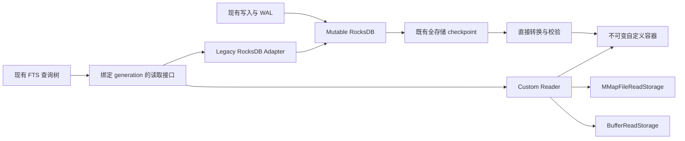

# FTS 自定义不可变索引 v1：实施设计与交付边界

日期：2026-11-17。状态：设计已收敛，尚未实现。

本文是后续实施会话的主规范。它以 [原设计](fts-custom-index-design.md) 为基础，吸收 [AGY 方案](fts-design-agy.md) 的可用优化，并以用户最后确认的范围覆盖两份历史文档中更大的实施范围。原文档保持不变，用于追溯。

## 1. 本期范围与不可变约束

本期采用 **writing segment 继续使用 RocksDB，seal 时直接输出自定义不可变 FTS 文件**。新旧不可变段可以共存，通过统一读取接口查询和合并。

| 项目 | 本期决定 |
|---|---|
| 可写 FTS | 保留现有 RocksDB、CF、WriteBatch 和上层 WAL 路径 |
| seal | 从可写辅助 CF 直接生成自定义格式，不先生成 BitPacked 再写回 RocksDB |
| 不可变读取 | mmap 与 buffer pool 同期交付，使用同一磁盘编码 |
| 模式来源 | 沿用 DB 创建时持久化的 `enable_mmap`，重开使用该模式 |
| 查询能力 | 保持当前精确词项、短语、布尔组合、过滤、候选集与 BM25/Top-K 行为 |
| wildcard / regex | 明确延期；不增加语法、AST、执行器、参数或扫描匹配功能 |
| FM-index | 明确延期；只保留词典身份、寻址能力和通用可选扩展机制 |
| 文档长度 | 精确 uint32，独立存储；presence 区分缺字段与零 token |
| 统计 | 保持现有 seal 与 reducer 各自的统计口径，不同时修正历史评分语义 |
| 迁移 | 明确的旧格式转换任务，覆盖只有一个 segment 的情形 |
| 发布 | 新文件持久化并校验后提交版本，再发布 reader，最后延迟回收旧文件 |
| 代码变更边界 | 不替换其他 RocksDB 用户，不重做数据库事务/MVCC，不顺带修改分词器 |

本期也不实现内存 mutable runs、动态 FM、反向词典、trigram、全局 BM25、SmallFloat norm、FP16 上界、窗口 mmap 或新的公共备份 API。保留 RocksDB 不代表当前写入内存已经具有全局硬上限；本文对新增 reader/writer/reducer 工作区提出有界要求，不对整个数据库 RSS 作额外承诺。

本文定义后续实施范围，不表示代码已经改动。后续实现会话按本文任务包推进，遵守仓库 `AGENTS.md`。

## 2. 当前实现事实与收益口径

当前主要开销是 positions 的 `(term, docID)` 小 KV、postings 中重复的 doclen、短倒排固定头部，以及按 term 获取完整 RocksDB value 的读取粒度。

- 每字段每文档一次 WriteBatch；若有 U 个不同词，包含约 `4U+1` 条操作，不是 `4U+1` 次独立 Write。
- postings 使用 Roaring Merge operands；不能假定每次写入都读取并重写完整倒排。
- RocksDB WAL 已关闭，恢复依赖上层 WAL；本期不声称节省第二份 WAL。
- FTS 仅注册 per-CF merge operator，不能把全局 merge operator 分支里的 8 MiB 配置当成当前 FTS 实际 write-buffer 大小。
- `OptimizeLevelStyleCompaction()`、默认 block cache 和实际压缩配置都要以运行时 options 为准。
- 最终格式收益不等于 writing 去 RocksDB 的收益；本期不做后者。

基准分开报告：mutable SST、seal 输入/输出、新格式各 section、临时文件和旧 generation。不得把未压缩 KV 账本直接当作 SST 磁盘体积，也不预设压缩或加速倍数。

## 3. 架构与读取接口



以下是职责契约，类名可以按现有代码习惯调整；不要为每个小方法创建独立层级。

| 模块 | 必需职责 |
|---|---|
| FtsReadHandle / ReaderGeneration | 持有 reader、storage owner、格式身份和封存统计，保证资源存活 |
| FtsSegmentReader | 精确 lookup、打开 posting cursor、读取 doclen/positions、取得统计 |
| TermDictionaryReader | 有序遍历、seek/seek_ge、按 ordinal 获取词条及元数据；服务转换与合并 |
| PostingCursor | 单调 next/advance、TF、块范围、上界与位置引用；不暴露 RocksDB CF |
| PositionAccessor / PositionCursor | 按 posting 打开位置流，提供 next/seek_ge；可批量访问，按需读取 |
| FtsContainerWriter | 流式写排序词项及固定大小 posting 块，完成容器和验证信息 |
| FtsReducer | 接受旧新 reader，沿用数据库文档重映射，输出新格式 |

`TermHandle` 必须携带词项身份及 generation 所有权，不能只返回丢失 term 字节/ordinal 的 `TermInfo`，又要求调用方自行补 term 打开 iterator。Legacy adapter 可保留字符串 key；新 reader 使用字段局部 ordinal，不要求 mutable 新建 termID 分配器。

继续复用现有 `DocIterator`、Term/Phrase、AND/OR 和 Top-K。Phrase 对 RocksDB MultiGet 的依赖移入 PositionAccessor；新格式的短语验证改为有界位置 cursor 的单调定位/交集，不能沿用把所有位置解码为 vector 的路径。重复 phrase term 保留独立的逻辑词序、游标状态和评分贡献，底层页可以共享。查询长度决定的游标数量也纳入查询预算；资源不足显式失败，不退回全量位置缓存。`advance(target)` 继续是定位操作，不引入会遗漏 SHOULD 贡献的竞争分剪枝。

接口必须区分缺词、EOF、I/O 失败、损坏、未知格式和资源超限。若保留现有返回 DocID 的迭代接口，必须增加可检查的错误状态，并在搜索返回前汇总；不能用 EOF 掩盖读取失败而返回部分结果。

本期不增加 `PatternPlanner`、`PatternIterator`、`match_regex`、`TermFmReader` 或空实现。内部有序词典能力本身不是公开 prefix/wildcard 查询功能。

## 4. 双读取模式与范围访问

`enable_mmap=true` 使用 MMapFileReadStorage；否则使用 BufferReadStorage。模式从 DB 持久化配置传入，FTS 不增加独立模式开关。mutable/legacy RocksDB 的内部读取方式沿用原实现；双模式约束适用于新增不可变容器。

复用 IndexStorage 的 MemoryBlock/ScatterBlock 或等价有所有权的范围句柄。返回指针只在句柄有效时可访问；mmap 也不能提前主动 close 映射。缓存身份至少包含 `base_id + base_generation + section + page`，或等价的唯一文件句柄身份；不能仅用可能在不同文件中重复的 generation 编号。

必须支持：

- 单页 pin；同页连续块可复用当前句柄。
- 跨页 scatter 或有界 scratch；当前 read_scatter 在部分冷页等情况下可能回退，不假定总能零拷贝。
- 缓存不足时受预算控制的 bypass，或明确资源不足；禁止无限 pin。
- short read、offset+length 溢出、越界和 checksum 失败的错误传播。
- 目录也分页：不在 open 时读入全部词典、skip、positions 或 doclen。

页局部性是 writer 优化，不是 reader 正确性的前提。`kVectorPageSize` 来自运行平台页大小，不能等同固定 4 KiB。文件可声明独立的 `layout_granule`；即使另一平台的 cache 页大小不同，格式仍必须可读。

小块可通过页尾 padding 尽量不跨布局粒度，但按**文件绝对偏移**计算，计入外层容器头和 section 起点。不能仅将 section 内偏移对齐。padding 是否启用及空间成本需测量，不承诺固定浪费率或 100% 零拷贝。

## 5. 容器、元数据与扩展协议

### 5.1 文件与 section

外层使用现有 FileDumper / IndexPacker / IndexUnpacker 容器。自定义头放在 `fts.meta` section 内，不向现有 storage 传入不兼容的裸文件。路径通过 FileHelper 管理；拟议名称包含唯一 generation，禁止原地覆盖：

```text
fts.<block_id>.<base_generation>.zfts
  fts.meta
  field.<ordinal>.terms
  field.<ordinal>.term_index
  field.<ordinal>.term_meta
  field.<ordinal>.doclen
  field.<ordinal>.presence
  field.<ordinal>.postings
  field.<ordinal>.skips
  field.<ordinal>.positions
  field.<ordinal>.position_index
  checksums
```

每个 FTS block 一个多字段容器；不为每个 term/page 创建独立文件或外层 section。物理 section 可合并，但逻辑引用和分页能力不变。空字段仍有元数据，零长度数据 section 必须具有合法表示。

新格式内部使用显式 little-endian 编码，禁止直接 memcpy C++ struct 作为磁盘协议。uvarint 规定最大字节数并拒绝溢出。文件偏移和长度使用 uint64，所有转为 size_t 的位置检查平台范围；超出本平台能力时明确拒绝，不能截断。

2026-11-18 用户调整：参考 zvec 向量索引，仅在打开时做有限校验。正常 open（含发布前预打开）检查外层头尾/目录、版本、身份、受限大小的 FTS 元数据及必要目录；不扫描全部数据页。查询范围读取不计算 SHA-256，也不为校验建立副本缓存；继续检查 offset/length、short read 和解码结构。格式中已有块/页摘要及受保护的 checksum 目录保留，完整验证仅由显式诊断入口执行，不在正常打开、查询或发布流程自动执行。因此不再承诺普通查询能检测全部数据位翻转。新增内层协议不能掩盖外层既有端序/平台限制，跨平台支持必须实际验证。

### 5.2 基础元数据

下列为新协议的语义字段，不是现有 manifest 字段名或已分配 wire tag；实施时先读 manifest codec，再在不复用旧编号的前提下编码。

| 字段组 | 必需信息 |
|---|---|
| 格式 | major/minor、header/record 长度、required_features、optional_features |
| 文件身份 | base_id、base_generation、block_id、来源 segment 身份 |
| 文档域 | local row count、合法 DocID 范围及映射契约 |
| 目录 | 字段目录、section 引用、offset/length、codec 和 checksum 引用 |
| 读取兼容 | 最低必需 reader/codec 版本；未知必需特性拒绝打开 |
| 扩展编码 | 可跳过的有长度可选记录；未知可选记录不能影响基础解码 |

required/optional feature 表示**本文件的编码要求**，不表示后台 FM 是否就绪。不能以后为了 attach FM 而修改已发布 base 的 feature 位。

每字段元数据至少包含：

- 持久字段身份与 incarnation、字段名、容器局部 field ordinal。删除后同名重建必须产生新 incarnation。
- segment_row_count、field_present_count、scoring_document_count、total_tokens、statistics_policy。
- dictionary_generation、term_count、term_order/term_encoding_version、dict_fingerprint_algorithm 与 dict_fingerprint。
- 分词器与 filters 的持久配置身份；只记录，不重新分析历史词项。
- posting/position/doclen/skip codec、评分参数身份、上界编码类型及其有效统计身份。

`base_id` 和字段 incarnation 使用持久且不会因路径复用而混淆的身份。仅用字段名或文件路径不够。

### 5.3 词典指纹与未来辅助索引

termOrdinal 是字段内最终词项按无符号字节序排序后的 `[0, term_count)` 序号，仅在指定 dictionary generation 内稳定。它可以由词典块的 first_ordinal 和块内序号推导，不必逐词重复存储。合并或字段重建后允许重新编号。

词典指纹采用带算法 ID 的强摘要；v1 默认选 SHA-256，采用流式计算，不缓存全部词典。canonical 输入必须在 codec 测试中固定：域标识、term_order/encoding 版本，以及按 ordinal 顺序的 `u64_le(term_length) + term_bytes`，最后包含 `u64_le(term_count)`。字段/base 身份单独绑定，不能仅靠内容摘要判定文件可替换。优先复用项目可用的跨平台摘要实现；若无可用实现，在格式基础任务中落实实现和已知向量测试，不使用 std::hash 或 CRC 代替强摘要。

本期预留的是通用辅助资源描述的扩展能力：未来可以在 block descriptor/辅助清单中增加带长度的 optional entry，描述资源类型、独立 codec 版本、base/field/dictionary 身份、资源引用及完整性信息。v1 写出空集合或省略可选记录，不打开任何辅助资源。

未来 FM 可以只扫描基础词典建立独立 sidecar，再原子附加到辅助清单，不必重写基础 postings，也不影响数据 checkpoint/WAL。具体辅助文件名、FM 算法、alphabet、SA 采样、rank 格式及构建调度全部延期。

**本期禁止创建空 FM 文件、FM section、样本数组、rank 目录或 FM 配置开关。** 也不为未来 FM 给每词/每文档预留大块空洞。扩展占用仅限身份字段及可跳过的元数据机制。

## 6. 基础编码

### 6.1 词典与 TermMeta

词项保持当前分词后的精确字节，不做新的 Unicode 规范化或大小写处理。排序使用无符号字节比较；词项可包含不能用 C 字符串结束符表示的字节，必须携带长度。

普通词典块采用前缀压缩，同时限制词数和编码字节数：初始目标最多 64 词、普通块约 4 KiB 上限，先达到任一条件就结束块。稀疏目录保存首词定位信息、first_ordinal、term_count、逻辑偏移及长度；大目录继续分层分页，不要求全部常驻。

超长单词不能被截断或丢弃。格式支持显式 oversized 词条/外部字节范围引用，按范围读取；超出任务工作区预算时返回可重试的资源错误并保留源格式。不能因为一个长词把普通词典块大小限制取消。外部词字节同样参与 canonical fingerprint。

TermMeta 使用明确标签区分 inline/external posting 和 inline/external position。不能通过 offset=0、position=0 猜测类型；二者都可能是合法值。包含 DF、必要的总 TF、编码种类、数据范围和上界，offset/length 均有边界验证。按 ordinal 读取只解码对应元数据块。

### 6.2 Posting 分层

| 条件 | v1 默认编码 |
|---|---|
| df=1 | 内联完整 uint32 DocID 与 uint32 TF；可复用一个 64-bit 存储槽，含义由标签决定 |
| df=1 且 TF=1 | 再内联唯一 position；不向 posting/position 数据流写该词的条目 |
| 2≤df<128 | 紧凑 varint：首 DocID、后续 gap、按标志省略或保存 tf-1；无完整 skip |
| df≥128 | 128-doc BitPacked 块，DocID 与 TF 分流，按块 skip |

初始阈值是可版本化 codec 参数。后续可按实际编码大小优化选择，但必须保留互操作和 golden 测试，不在 v1 未验证前引入大量编码分支。

合法 DocID 为 `[0, UINT32_MAX)`，`UINT32_MAX` 保留为现有 iterator 的 EOF；同一词项的 DocID 严格递增且不重复。TF 必须为正且可表示为 uint32；doclen 为完整 uint32；总 TF/total_tokens 等累计量使用 checked uint64。写入和转换遇到溢出明确失败，不截断。

每个长块保存首 DocID；第一个 delta 强制为零，其余为块内相邻差值。TF 编码 tf-1，全为 1 时位宽为零。块中移除重复 doclen。

拟议固定块头为 8B：首 DocID、两路位宽、文档数和 flags；文档数范围 1..128。payload 大小按真实 count/bitwidth 计算并校验。两路都使用 32 bit 时，128-doc 块可达约 1032B，不能把 400B 当上限。复用现有 SIMD 能力及 scalar fallback，不改变支持平台。

skip 保存块末 DocID、posting/位置目录定位和保守 FP32 上界。v1 偏移优先使用 uint64；不照搬未定义跨度限制的 32-bit relative offset。若以后引入紧凑 offset，必须有明确的宽度标签与升级路径。完整 skip 不常驻；目录按页/多级定位。

### 6.3 DocLen、Presence 与统计

按父 segment-local row ID 存储精确 uint32 doclen，每百万行每字段约 4 MB。presence 独立 bit-packed 保存：缺字段为 false/0，存在但零 token 为 true/0。

v1 选择 presence bitmap，以保留完整 uint32 长度值域；不采用 UINT32_MAX 空值 sentinel，不做有损 norm。长度列不能按“字段实际收到的插入次数”直接 push_back，必须覆盖缺字段产生的行号间隙。

统计规则：

1. **新 seal / 纯格式转换**：保留源字段 N、total_tokens、DF 和评分参数。零 token 文档与缺字段分别按来源契约恢复。
2. **旧 sealed 转换**：从旧 posting 恢复有 token 行的 doclen；从 forward 读取字段存在性；没有 posting 的行长度为零。不得重新分词。
3. **普通 reducer 合并**：沿用现有 reducer 的删除过滤、目标物理行数 N 及总 token 计算口径；另存真实 field_present_count。不能改成按 presence 计算评分 N。
4. 源统计缺失、冲突或 presence 无法恢复时，任务明确失败并保留旧 reader；不猜测数据。

`statistics_policy=legacy_compatible` 为本期唯一写出策略。后续改成字段存在数等规范统计属于独立重建，不与本次存储迁移混合。

### 6.4 Positions 与字节寻址

同一 term 的位置按 posting 顺序存储，每文档独立编码，位置从绝对首位置开始、后续 delta-varint。position 使用完整 uint32 值域，按非递减顺序编码，保留源中的重复位置，不去重或重排。解码检查 varint 宽度、delta 累加溢出和实际位置数量与 TF 一致性；短语位置加减也须检查边界。普通 BM25 查询不读 positions。

采用 posting block 位置目录 + 块内字节检查点。初始每 32 篇文档一个检查点，检查点同时定位该文档的 positions 字节起点和长度目录的字节起点。相对偏移可根据实际范围使用 16/32/64-bit，必须带宽度标志。

为了真正限制定位开销，v1 的 position_index 还保存每文档的编码字节长度（varint），长度覆盖该文档在 positions 流中的完整连续占用，包括放在流内的子块头；独立目录的引用单独记录。定位时从双偏移检查点出发，最多累加前面 31 个文档长度，再读取目标长度，不必扫描长度目录起点或解析前面文档的 position varint。这个长度目录有空间代价，应在基准单独列账；不能只保留几个检查点便宣称高 TF 文档下的定位成本有界。

超长单文档位置列表使用有界子块和分页目录。子块记录恢复位置所需的基准、数量及字节范围，顺序解码只保留当前块。position=0 合法；不得把它用作无位置标志。短语验证可以消耗较长时间，但不能要求一次加载整个长列表。

只在文档独立编码、位置值、codec 和子块边界都兼容时复制现有位置字节；否则流式解码重编码。源码中旧 positions value 可能已完整物化，旧格式 adapter 的这一限制不能被宣传为已解决。

### 6.5 BM25 与安全上界

不修改现有 scorer、AST rewrite、默认操作符、重复词、过滤、候选集和 collector 同分行为；不引入原模式方案中的新 tie-break 规则。公开字段前缀/boost 等当前被拒绝的语法继续保持原行为。

封存时按固定统计和现有浮点评分路径计算权重为 1 的 FP32 block max 与 term max，并绑定统计、参数和上界计算版本。不得用普通舍入的 FP16 上界。合并改变 DF/N/avgdl 时重算上界。

v1 只在统计、参数、浮点评分路径匹配且有效 boost=1 时使用该有限上界；其他情况返回正无穷并禁用对应剪枝。特别是重复词产生 boost=3 等内部权重时，不能直接把保存的 max 乘 boost：`(idf * tf_norm) * boost` 可能比实际 scorer 的 `(boost * idf) * tf_norm` 低一个 ULP。不得用任意 epsilon 或改变实际 scorer 掩盖问题。跨平台/编译选项使计算路径无法确认一致时同样保守退化；若后续采用最大 tf_norm 或定向舍入来恢复有限上界，需要独立的保守性证明、codec 标记和差分测试。

有效上界在查询层统一决定，覆盖 `cached_max_score_`、`max_score()` 和 `block_max_info_for()`，不在 TermIterator 外层再次乘 boost 或沿用旧有限缓存。显式传播“无有限上界”状态：依赖它的父节点禁用对应 WAND、跳块和剩余分剪枝并完整求分，不能执行 `∞−∞` 后依赖 NaN 的比较行为。有限子上界的聚合须保持与实际评分兼容的累加顺序或采用保守向上舍入，不改变实际分数计算。任何跳块优化都要与禁用剪枝的参考执行比较，尤其覆盖 SHOULD、candidate_ids、短语验证和同分候选。

普通重开不验证持久化 block/term max 的保守性，不能直接信任这些上界。当前 reader 可从实际 scorer 的统计/参数推导运行时饱和上界：严格 IEEE FP32 最近舍入下，分母不小于 float(tf)，以 `(k1+1)` 和四个 `(1+2^-24)` 舍入因子向上估算，再向上乘 IDF；可能溢出、非标准浮点环境或 boost 不为 1 时仍返回正无穷。它不改磁盘编码或实际得分，须保留数学说明、极值测试及禁剪枝差分；显式完整验证后的 reader 才使用较紧的持久化上界。

## 7. 从 RocksDB 直接 seal

### 7.1 来源与流式构建

保持现有全存储 checkpoint，固定本次转换的源 schema、DocID 域、删除状态、FTS 统计及 RocksDB 读取视图。首版允许沿用现有 seal 写入排他期，不以此任务为由引入异步 mutable 并发模型。

构建顺序：

1. 解码 doclen CF 的行号，先生成按数值 DocID 排序的长度/存在性流，再按行域补齐缺字段。当前 key 是 native-endian uint32，RocksDB 字节序迭代不保证数值行号有序；使用固定预算的磁盘分页临时列或外部排序，不能先攒全量 doclen vector。旧 sealed 的恢复路径单独使用 forward 与旧 posting。
2. 以 TF CF 解码得到的 `(term, docID)` 有序流为 posting 来源，与 positions 协调读取；不读取整个 Roaring posting 来重建同一信息。当前 key 是 `term + NUL + big-endian DocID`；不能对含 NUL 的任意词项假定原始 key 顺序等于解码后的词项顺序。先验证可直接顺序归组的条件，不满足时使用有界外部排序形成 canonical 顺序；临时记录可引用源 position key，避免为排序物化全部位置值。
3. 只缓冲当前词的固定数量 posting、必要的位置块和小型目录状态。大词的 skip、positions 和词典目录边生成边写。
4. 一个词结束后确定 DF、offset/length、inline 选择和 term max，再写 TermMeta/词典记录，递增 ordinal 并更新 fingerprint。DF 尚未完整时不能计算最终 IDF 上界；使用可回读的临时块摘要或额外顺序 pass 完成 block max，不把该词全部块摘要留在内存。
5. 完成所有 section、校验信息及容器元数据，有限预打开检查后交给发布协议，不重新扫描全部 posting/positions。

不要调用 `convert_postings_to_bitpacked()` 后再导出，不删除源 TF/maxTF/doclen CF，不为导出预先执行全量 CompactRange。

输出同一容器的多个 section 可以先写有界数量的临时 section 文件，再流式封装；临时磁盘与二次复制 I/O 必须计入基准。接口不承诺整个转换恰好一次扫描或一次写盘。也不得为了同步多个 section 把整份索引攒在内存。

源 RocksDB 已有单个大 value/单个超长 key 的物化开销仍可能超预算。新增转换器必须预留并检查所需工作区；无法在预算内处理时失败且保留源数据，不以无界 fallback 兑现转换成功。新格式到新格式的读取/合并才应完整满足分页和有界工作区契约。

### 7.2 持久化与发布状态机

```text
RecoverableSource
  → PreparedCustomFile
  → DurableVersionCommitted
  → ReaderPublished
  → OldGenerationRetired
```

两个持久点必须区分：既有 mutable checkpoint 提供恢复来源；新格式转换提交决定哪个不可变 block 成为权威。生成新 FTS 文件本身不能清理上层 WAL。

发布要求：

1. 源 checkpoint 的恢复保证经过核验，旧 RocksDB、forward 和版本保持可恢复。
2. 写临时新文件，完成并同步，校验，原子改名并同步所在目录；预打开新 reader 验证格式和配置。提前准备后继 writing segment 及发布所需资源，将可失败的分配/打开操作放在持久提交前。
3. 构造独立候选 metadata/version；将新 block 描述完整写入临时 manifest、同步并原子发布，明确 collection/segment 层级的权威引用关系。
4. 持久提交成功后，以不可失败或可幂等重放的步骤发布新 reader、sealed 状态及 writing segment 切换。
5. 旧版本不再需要且所有使用者释放后，关闭、删除旧 generation。删除失败只进入可重试回收队列。

当前 VersionManager/FileDumper 不能直接视为已提供上述保证：Version::Save 写最终编号文件、flush 提前递增版本并删除旧 manifest、恢复选择最大编号，FileDumper close 也不等于 fsync。必须补齐或明确封装发布协议，这是新格式安全切换的前置工作，不是另起一套数据库 WAL/MVCC。

当前 collection 切换路径在 manifest 成功前可能已修改 writing pointer/segment manager；新实现要将候选构建与发布分开，不能仅在旧流程中插入一个文件写入调用。

失败语义：

- 提交前失败：保留源 reader 与全部辅助 CF，丢弃候选；允许恢复写入后重新转换，新任务重新捕获源身份。
- 提交成功但内存发布未完成：重放已准备的发布步骤；若不能安全完成，则停止相关写入并重开已提交版本，不能恢复向旧 writing 状态写入。恢复时以持久权威记录为准。
- 提交后清理失败：继续使用已提交新版本，重试回收，不回退旧文件。
- 提交结果不确定：保留新旧文件，停止依赖该状态的切换，通过持久记录确认后恢复；不盲目回滚或删除。
- 重开只选择完整已提交版本；不能因编号最大或新文件存在就认为提交成功。

### 7.3 Reader 所有权

查询必须同时 pin reader 和其 storage/context owner。现有字段 indexer 的 ctx_ 是裸指针，仅持字段 shared_ptr 不足以保证原 RocksDB 存活。新只读 generation 负责 owner 生命周期，禁止其他路径提前主动 close。

旧查询可以在发布后结束；新查询使用已发布 generation。该机制仅解决资源安全，不扩展 mutable 事务可见性。沿用数据库现有进程文件锁，不新增跨进程 lease 服务。

## 8. 合并、迁移与 DDL

### 8.1 新旧混合 reducer

通过统一 source reader 接受 legacy 与 custom 段。先按目标文档域及既有删除规则确定统计与精确长度，再有序归并词典和 postings。DocID 映射必须与 forward 输出一致；不能以 `global_doc_id-min_global_doc_id` 代替 local row ID。

新格式输入按固定块流式处理，positions 按兼容条件复制或重编码。全词典、大词 posting 和全量输出 DocID-remap 数组不得无预算常驻；复用现有删除/rank 映射能力时明确其额外内存，不重复复制。

第一版优先保证编码一致和评分正确，块 payload 直接复制作为后续可测快路径。若保持碎尾块导致最终空间变大，要单独计费，不能声称“seal 零重写”。

### 8.2 迁移与版本兼容

格式由已提交 block descriptor 声明，legacy 缺失字段的默认值仍为旧格式。文件 magic 只做校验，不参与提交状态推断。新程序支持混读；未知必需基础版本拒绝打开，损坏已提交新 base 直接报错，不自动回退旧库。

增加独立 FTS rewrite task，覆盖单个旧 segment 且没有 purge 的情形。现有 optimize 可能只安排向量索引任务，不能假定它自然触发 FTS 转换。纯 rewrite 不重分词、不改 DocID、不改变删除标记或评分统计。

新格式写入在发布前必须验证旧二进制拒绝行为。历史 decoder 可能忽略新增字段，增加 minimum_reader_version 本身不能使所有已发布程序自动执行门禁。优先先交付兼容 reader/门禁，再启用新 writer；具体兼容版本和开启条件在 P0 固定。没有验证之前，新格式写入不能成为默认生产行为。

### 8.3 多字段、snapshot 与回收

create/drop/rebuild FTS 对新容器生成新 generation，包含所有仍有效字段；不原地修改旧容器。未变化字段可复制 section，但新 base 身份必须重新声明。字段同名重建分配新 incarnation。

将现有 RocksDB checkpoint snapshot 与不可变文件复制/硬链接分别适配。快照文件清单必须与固定 manifest generation 一致，并持有源 owner；硬链接只能用于不会再原地修改的文件。

DDL、字段 reload、正常 seal、迁移、合并共用发布和延迟回收契约。不能复用立即删除旧 FTS 目录的代码路径。验证关闭后的备份/恢复及现有内部 snapshot；不新增公共备份产品功能。

## 9. 源码落点与跨模块检查

| 位置 | 实施职责 |
|---|---|
| [fts_column_indexer](../src/db/index/column/fts_column/fts_column_indexer.cc) | 写路径保留；读取接入 reader；直接 seal 来源适配 |
| [fts_indexer](../src/db/index/column/fts_column/fts_indexer.cc) | generation owner、多字段容器、seal/snapshot/DDL 路由 |
| [iterator](../src/db/index/column/fts_column/iterator/fts_doc_iterator.h) | Term/Phrase 存储解耦，保留 Boolean/Top-K 契约 |
| [现有 reducer](../src/db/index/column/fts_column/fts_rocksdb_reducer.cc) | 提取共同语义，增加新旧源到 custom 目标的流式实现 |
| 拟议 fts_column 内 format/storage 子目录 | codec、字典、positions、writer/reader、校验与有界缓冲 |
| [segment](../src/db/index/segment/segment.cc)、[segment_helper](../src/db/index/segment/segment_helper.cc) | checkpoint、准备转换、混合合并、字段生命周期 |
| [collection](../src/db/collection.cc) | 持久模式传递、单段迁移任务、准备/发布切换 |
| [meta](../src/db/index/common/meta.h)、[manifest codec](../src/db/index/common/manifest/manifest_codec.cc)、[version_manager](../src/db/index/common/version_manager.cc) | 格式描述、可选扩展、兼容门禁和持久提交 |
| [file_helper](../src/db/common/file_helper.cc) | 新文件类型、generation 路径、快照清单与回收 |
| [core storage](../src/include/zvec/core/framework/index_storage.h) | 复用双后端；必要改动集中于范围读取/持久化契约 |
| [fts_bench](../benchmarks/fts/fts_bench_main.cc) | 分项空间、seal/merge 读写量、双模式查询与峰值资源 |

实际 manifest schema 以当前 manifest_codec 为准；不得根据历史 proto 路径猜字段编号。本期原则上不改公共 FTS 查询参数、ANTLR grammar 或 binding；确需新增公开配置时才按仓库规则联动全部 binding/SDK，并重新审查范围。

## 10. 可独立实施的任务包

所有任务都以本期无 wildcard/regex/FM 为前提。名称为建议交付单元，不要求现在创建 issue、分支或会话。

| 阶段 | 交付与依赖 | 验收出口 |
|---|---|---|
| P0 基线与协议冻结 | 核实当前统计、实际 RocksDB 配置、metadata/writer 开启机制、旧版本门禁；确定内存预算和性能基线 | 记录当前代码 revision、测试数据和评分对照；列清必须修复的发布前置项 |
| P1 格式与双后端 | 元数据/扩展编码、指纹、词典、posting、doclen/presence、positions；独立 Writer/Reader | golden、畸形文件、边界整数、跨页、双模式读写往返通过；暂不接生产 seal |
| P2 查询 seam | LegacyAdapter、generation owner、Term/Phrase 接入 custom reader、有界 PositionCursor 与短语验证 | 既有语法、结果、评分、过滤、candidate_ids 与同分行为差分通过；单文档超高 TF 不导致全量位置缓存 |
| P3 直接 seal 与安全发布 | 依赖 P1/P2；从 CF 输出新文件，补齐发布依赖、失败重试、延迟回收 | 故障注入、重开、继续写入后重试、长查询跨发布通过 |
| P4 合并与历史迁移 | 新旧混合 reducer、单段 rewrite、统计/presence 恢复、版本兼容、多字段 DDL 和 snapshot/备份文件适配 | 纯转换等价、删除重映射、多字段 DDL、snapshot/备份通过 |
| P5 性能与启用 | 同条件对比基线，检查资源上限与回归，验证计划支持的平台 | 正确性与恢复为硬门槛；性能结论有数据后再启用新 writer |

P1 与发布基础设施检查可以并行，但 wire format、generation 和统计协议只能由一个明确版本维护。其他会话不得自行扩展本期功能。新增文件后按实际 CMake 配置重新生成构建，不解析或提交构建产物。

## 11. 测试与验收

### 11.1 正确性矩阵

- 同一输入在 legacy、新格式 mmap、新格式 buffer pool 下比较精确词项、短语（含重复词）、AND/OR/NOT、过滤、candidate_ids、Top-K。
- 同一逻辑分段下比较 seal 前后、重开后、纯 rewrite 后的 N、DF、TF、doclen、total_tokens 与分数；不通过改变 segment 边界掩盖差异。
- df=1/2/127/128/129、TF=1 与大 TF、position=0、重复位置、跨位置子块、DocID 大 gap、最高合法值、尾块、64-bit offset/length、含 NUL/超过普通词典块的词项。
- 缺字段、空文本、过滤后零 token、多字段、删除更新、global DocID 空洞及旧新混合 merge。
- WAND/BlockMax 对照禁剪枝参考执行；覆盖 SHOULD 的 advance、低阈值、同分、短语二阶段验证和重复词产生 boost=3 的浮点结合顺序差异。
- 冷页、频繁驱逐、跨页、全部页被 pin、bypass、缓存不足和并发 reader；检测悬空指针和提前 unmap/close。
- 截断、打开时元数据 checksum 失败、未知 required feature、可跳过 optional record、整数溢出、错误 section 引用、short read：明确错误，不返回少召回的成功结果。数据页/校验目录的 checksum 失败由显式完整验证测试覆盖，不再要求查询逐页检查。

普通 term 的分数沿用现有运算路径。允许的浮点误差必须来自基线测试的既有契约，不能用扩大容差掩盖统计或 norm 变化；同分行为不另立规则。

### 11.2 生命周期矩阵

在临时数据写入、完成/同步、rename、manifest 写入/发布、reader 切换、旧文件关闭/删除处注入失败。重开应只见完整旧版本或完整新版本。

覆盖 seal 失败后重试、失败后继续写入再 seal、提交成功但内存发布未完成、提交状态不确定、清理失败、长查询跨发布、任务取消、Windows 占用文件、多字段 create/drop/rebuild、单段迁移、只读打开、备份恢复与真实旧程序打开行为。

基础文件一经提交后损坏必须报错；遗留旧副本不是自动回退依据。FM/wildcard/regex 不在验收矩阵内；扩展测试只验证元数据身份、ordinal 稳定性和未知可选记录的跳过。

### 11.3 构建与执行

先运行受改动影响的目标；以下为当前存在的相关测试目标，不能以列表代替按变更选择覆盖面：

```sh
ninja -C build.release unittest.fts_column_indexer_test unittest.bitpacked_posting_list_test
ninja -C build.release unittest.fts_rocksdb_reducer_test unittest.fts_candidate_iterator_test
ninja -C build.release unittest.fts_query_test unittest.fts_recall_test unittest.fts_multi_segment_test
ninja -C build.release unittest.buffer_read_storage_test
ninja -C build.release unittest.manifest_codec_golden_test unittest.version_manager_test
```

新增 custom codec/storage、publication/recovery 的测试目标需在对应阶段补齐。C++ 按仓库规范运行 clang-format 检查；如果改公开 C/Python 契约，执行相关 binding 和 Python 测试。新增依赖或 CMake 变化必须核验 Linux/macOS/Windows/iOS/Android 的相关 CI 构建。

### 11.4 性能与资源

对照至少包含当前 legacy 与新格式两种读取模式。保持同样数据、tokenizer、逻辑 segment 边界、持久性、可见性、CPU/I/O 额度和内存预算；记录实际压缩与缓存配置。

空间分别报告词典/TermMeta、postings、positions、位置长度/检查点、doclen/presence、skip、checksum、padding、临时构建文件和旧 generation。原文、向量、数据库 WAL 单独列示。

时间与资源分别报告 mutable 写入、seal、merge、冷/热查询 P50/P95/P99、读取页/字节、解码块数、cache hit、工作区峰值、RSS 和临时磁盘峰值。buffer pool 的页缓存与 scratch 要计费；mmap 的虚拟地址空间不等于 RSS，整文件映射不构成 RSS 硬限制。

新增 reader/writer/reducer 不应因累计 posting 数而物化全量数据；旧 adapter 的大 value 限制单独报告。对 mutable RocksDB 的配置改进、tokenizer 流式化或大 value 分块属于另一个变更，不能混入本次收益后不单列。

## 12. 对 AGY 方案的最终取舍

| 项目 | 本期处理 |
|---|---|
| 单例 posting 内联 | 采纳，完整 DocID/TF 与显式标签 |
| 单例且 TF=1 的 position 内联 | 采纳，position=0 合法 |
| 64 词前缀压缩块 | 采纳初始词数，同时限制字节；支持长词 |
| 小块页局部性、同页 pin 复用 | 采纳优化方向，保留跨页与 bypass 正确路径 |
| 块首 delta=0、tf-1 | 采纳到新 codec，不要求本期重写所有旧格式 |
| 位置检查点 | 采纳，并补文档字节长度和长列表分块 |
| 精确 uint32 doclen | 采纳；缺字段使用 presence，不占用长度 sentinel |
| 32-bit relative offset | 不直接采纳；v1 优先 uint64，后续紧凑编码需显式升级机制 |
| “400B 最大块、padding<3%、100% 零拷贝” | 不作为保证，改为准确上界与实测指标 |
| rename 后立即删除 RocksDB | 不采纳，必须先持久发布版本并等待使用者释放 |
| FM 词首定位、直接 termID 采样 | 只保留历史研究价值，本期不实现也不固定格式 |
| 反向 DFA × FM、模式 AST/评分 | 明确延期，不属于本期任何任务包 |

后续扩展首先读取本文件的身份、ordinal、只读 generation 与可选记录契约，再单独设计模式语义和 FM codec。不得直接照搬 AGY 中按 SA 行号采样却宣称 K−1 次 LF、或漏掉最后词项的词界算法。
