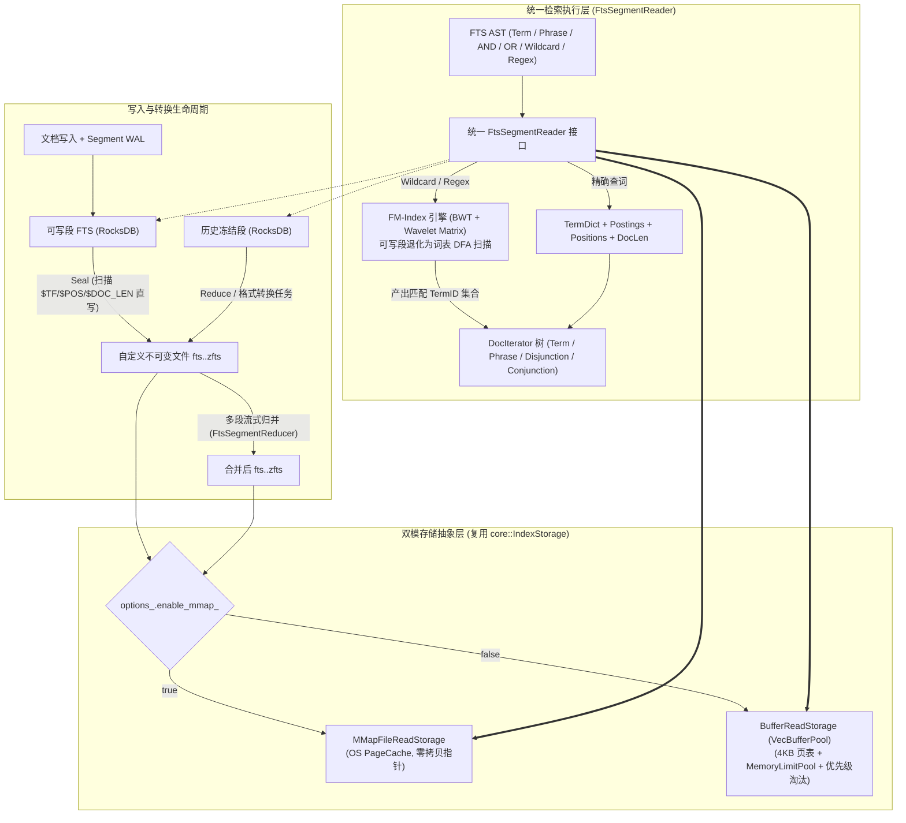
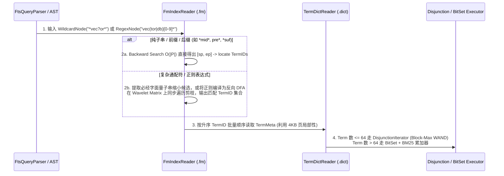

# Zvec FTS 自定义索引格式与 FM-Index 检索设计方案

结合前两轮讨论的共识（**“可写段暂留 RocksDB、冻结段切换为专用倒排文件、分层渐进验证”**），并纳入新增的两项核心需求（**1. 同时支持 MMap 与 BufferPool 双模式读取；2. 内建 FM-Index 支持 Wildcard 与 Regex 检索**），以下产出完整的架构与格式设计方案。

---

## 一、现状诊断：为什么当前基于 RocksDB 的 FTS 索引空间大、性能受限？

结合现有代码（[fts_indexer.cc](file:///Users/jiliang.ljl/Project/vector/zvec/src/db/index/column/fts_column/fts_indexer.cc)、[fts_column_indexer.cc](file:///Users/jiliang.ljl/Project/vector/zvec/src/db/index/column/fts_column/fts_column_indexer.cc)、[bitpacked_posting_list.cc](file:///Users/jiliang.ljl/Project/vector/zvec/src/db/index/column/fts_column/posting/bitpacked_posting_list.cc)、[fts_rocksdb_reducer.cc](file:///Users/jiliang.ljl/Project/vector/zvec/src/db/index/column/fts_column/fts_rocksdb_reducer.cc)、[rocksdb_context.cc](file:///Users/jiliang.ljl/Project/vector/zvec/src/db/common/rocksdb_context.cc)），我们对单个 Segment 的 FTS 索引进行定量拆解。

> **基准测算模型**：假设单 Segment 含 **100 万篇文档（1M docs）**，平均文档长度 150 tokens（去重后每篇 100 个 unique terms），词表规模（Vocabulary）50 万，总计 **1 亿（$10^8$）个 `(term, doc_id)` 倒排项**、**1.5 亿个词位置（positions）**。

### 1. 空间膨胀的四大根因

#### 根因 ①（头号杀手，占索引体积 65%~75%）：`$POSITIONS` CF 采用 `term\0doc_id` 作为独立 RocksDB KV
* **现状**：在 [fts_column_indexer.cc](file:///Users/jiliang.ljl/Project/vector/zvec/src/db/index/column/fts_column/fts_column_indexer.cc#L652-L655) 中，每个 `(term, doc_id)` 组合在 `$POSITIONS` CF 中存为一条独立的 RocksDB KV（Key = `term + '\0' + doc_id(4B BE)`，Value = varint delta positions）。
* **定量账本**：
  * 1 亿个 `(term, doc_id)` 产生 **1 亿条 RocksDB KV**。
  * **实际有效载荷（Value）**：平均 `tf ≈ 1.5`，varint delta 编码仅占 **1.5 ~ 2 字节**（总量仅 **~180 MB**）。
  * **RocksDB 每条 KV 的固有元数据开销**：
    1. **Key 开销**：即便 SST Data Block 开启前缀压缩，每条记录仍需 `shared_len(1B) + unshared_len(1B) + doc_id_suffix(4B)` = **6 字节**，且每 16 条（默认 restart interval）存储完整 Key 与 4B 偏移（均摊 **~1 字节**）；
    2. **RocksDB InternalKey 尾部**：每条 KV 强制附带 **8 字节**（`SequenceNumber(7B) + ValueType(1B)`）；
    3. **Value 长度前缀**：varint **1 字节**；
    4. **全局 Bloom Filter 与 Index 开销**：[rocksdb_context.cc](file:///Users/jiliang.ljl/Project/vector/zvec/src/db/common/rocksdb_context.cc#L269) 对所有 CF 无差别开启了 `NewBloomFilterPolicy(10, false)`，1 亿条 Key 仅 Bloom Filter 就消耗 **~125 MB**，加上 Data Block Index 约 **30 MB**。
  * **结论**：原本 **~180 MB** 的位置数据，在 `$POSITIONS` CF 中膨胀至 **1.8 GB ~ 2.2 GB**（**空间放大 10~12 倍**）。

#### 根因 ②：`BitPackedPostingList` 内联重复存储 `doc_len`（文档长度）
* **现状**：[bitpacked_posting_list.cc](file:///Users/jiliang.ljl/Project/vector/zvec/src/db/index/column/fts_column/posting/bitpacked_posting_list.cc#L316-L317) 在每个 Block 中同时打包了 `deltas` (`doc_id`)、`tfs` 和 `doc_lens`。
* **问题**：`doc_len` 是**文档级属性**（仅与 `(field, doc_id)` 有关，与 `term` 无关）。一篇含 100 个唯一词的文档，其 `doc_len` 在 100 条倒排链中被**重复存储了 100 次**。
* **定量账本**：1 亿个倒排项按平均 `bitwidth_dl = 9~10 bits` 算，仅 `doc_len` 就占用了 **~115 MB ~ 125 MB**。若将其抽离为 Segment 级定长数组 `uint32_t doc_lens[N]`，100 万文档仅需 **4 MB**，可节省 **96%+** 的 `doc_len` 编码空间。

#### 根因 ③：长尾低频词（Zipf 定律）的固定头部、对齐膨胀与块首 delta 位宽退化
* **长尾短链固定开销**：自然语言词表中 **60%~80% 的词只出现 1~5 次（`df <= 5`）**，**90%+ 的词 `df < 128`**（不足一个 Block）。[BitPackedPostingList::encode](file:///Users/jiliang.ljl/Project/vector/zvec/src/db/index/column/fts_column/posting/bitpacked_posting_list.cc#L243-L257) 对哪怕 `df = 1` 的单例词（Singleton）也固定输出 `Header(16B) + SkipList(12B) + align_up(16) -> 32B` + `BlockHeader(16B) + packed_data(~3B) + align_up(16) -> 32B` = **64 字节**（加上 RocksDB Key + 8B InternalKey + 10-bit BloomFilter 约 **85 字节**），而实际有效信息仅 `(doc_id, tf)` **2~5 字节**。
* **块首 delta 参与位宽计算的缺陷**：在 [bitpacked_posting_list.cc](file:///Users/jiliang.ljl/Project/vector/zvec/src/db/index/column/fts_column/posting/bitpacked_posting_list.cc#L178-L181) 中，`deltas[0] = doc_ids[0]`，后续每个块首 `deltas[start] = doc_ids[start] - doc_ids[start - 1]`，并在 `max_128` 中参与了整块 `bitwidth_id` 的计算；然而解码端 `BlockHeader` 已存有 `min_doc_id = doc_ids[start]`，块首 `deltas[start]` 在还原时被忽略或抵消。若某词首次出现在较大 `doc_id`（如 `500,000`，需 19 bits），而块内后续 127 个文档间隔仅为 `1~3`（仅需 2 bits），会导致整块 128 个数被迫按 19 bits 打包。

#### 根因 ④：整条 Posting Value 读取粒度与 `seal()` 写放大
* **整条 Value 读取**：[fts_column_indexer.cc](file:///Users/jiliang.ljl/Project/vector/zvec/src/db/index/column/fts_column/fts_column_indexer.cc#L371) 的 `db_->Get(..., term, &raw_data)` 会将高频词的**整条 Posting List（包含所有块）一次性读入 `PinnableSlice`**。SkipList 跳块只省了 CPU 解包，没有减少 I/O 读取粒度。
* **Seal 二次写放大**：写入期先写 5 个 CF（`$POSTINGS`、`$POSITIONS`、`$TF`、`$MAX_TF`、`$DOC_LEN`），`seal()` 时再全表扫描 `$TF` 和 `$DOC_LEN` 转成 BitPacked 写回 `postings_cf_`，且未对 `postings_cf_` 触发 `CompactRange` 清理旧 Roaring SST。

---

## 二、总体架构设计

### 1. 核心设计原则
1. **读写演进解耦**：可写段（Mutable Segment）暂保留 RocksDB 写入与 Checkpoint，不触碰现有 WAL 清理时序（[segment.cc](file:///Users/jiliang.ljl/Project/vector/zvec/src/db/index/segment/segment.cc#L2163-L2172)）；冻结段（Seal 产物）与合并段（Reduce 产物）输出**自定义单文件容器 `fts.<block_id>.zfts`**，生成并发布后直接回收原可写段的 RocksDB 目录。
2. **MMap 与 BufferPool 双模统一存储**：直接复用 Zvec 内核已有的 [core::IndexStorage](file:///Users/jiliang.ljl/Project/vector/zvec/src/include/zvec/core/framework/index_storage.h#L32) 体系（[MMapFileReadStorage](file:///Users/jiliang.ljl/Project/vector/zvec/src/core/utility/mmap_file_read_storage.cc#L26) 与基于 [ailego::VecBufferPool](file:///Users/jiliang.ljl/Project/vector/zvec/src/include/zvec/ailego/buffer/vector_page_table.h#L527) 的 [BufferReadStorage](file:///Users/jiliang.ljl/Project/vector/zvec/src/core/utility/buffer_read_storage.cc#L85)），受集合级 `options_.enable_mmap_` 统一控制，共享进程级 [MemoryLimitPool](file:///Users/jiliang.ljl/Project/vector/zvec/src/include/zvec/ailego/buffer/block_eviction_queue.h#L180) 与三级优先级淘汰队列 [BlockEvictionQueue](file:///Users/jiliang.ljl/Project/vector/zvec/src/include/zvec/ailego/buffer/block_eviction_queue.h#L65)。
3. **词典级 FM-Index（Vocabulary FM-Index）内建支持 Wildcard / Regex**：对段内去重词表构建紧凑的 BWT + Wavelet Matrix，以亚毫秒级耗时将任意子串/通配符/正则模式展开为匹配 `term_id` 集合，再无缝接入现有倒排迭代与 BM25 / WAND 执行引擎。



---

## 三、自定义容器文件格式与 BufferPool 友好布局设计

### 1. 复用 `IndexPacker` / `IndexUnpacker` 容器框架
不重复造文件头尾校验轮子，直接采用 [core::IndexPacker](file:///Users/jiliang.ljl/Project/vector/zvec/src/include/zvec/core/framework/index_packer.h#L28) 与 [core::IndexUnpacker](file:///Users/jiliang.ljl/Project/vector/zvec/src/include/zvec/core/framework/index_unpacker.h#L28) 打包 `fts.<block_id>.zfts`。容器自带 `MetaHeader`、`SegmentMetaBuffer`、`MetaFooter` 及分段/全文件 `CRC32C` 校验，且天然可被 `MMapFileReadStorage` 和 `BufferReadStorage` 直接打开。

每个 FTS 字段 `<field>` 在容器内注册 7 个逻辑子段（`IndexStorage::Segment`），所有子段起始偏移按 **4KB（`kVectorPageSize`）对齐**：

| 逻辑子段 ID | 存储内容 | BufferPool 缓存优先级 (`CachePriority`) |
| :--- | :--- | :--- |
| `<field>.meta` | 字段级统计（`total_docs`, `total_tokens`, `doc_count`, `vocab_size`, `flags` 等） | 打开时一次性读入内存常驻（仅 ~64B） |
| `<field>.dict_idx` | 词典稀疏块索引（每 64 个词的首词及偏移）+ FM-Index `C[257]` 表 | 打开时常驻或 `kHigh`（100KB 级） |
| `<field>.dict` | 词典数据块（64 词/块，块内前缀压缩 + `TermMeta`） | `kHigh`（`kExplicitHotPriority`） |
| `<field>.fm` | 词典级 FM-Index（8-level Wavelet Matrix Interleaved Rank Blocks + 采样 TermID 表） | `kNormal`（`kProtectedPriority`） |
| `<field>.doclen` | 文档长度数组 `uint32_t doc_lens[seg_doc_count]`（`UINT32_MAX` 表示字段缺失 `null`） | `kHigh`（每次打分必访，4MB / 1M docs） |
| `<field>.postings` | SkipList + 分层倒排链（`df=1` 内联词典，短链 varint，长链 128-doc SIMD 块） | SkipList `kNormal` / 数据块 `kLow` |
| `<field>.positions` | 按 Term 连续存储的文档内位置差分流（含块内每 16/32 文档字节偏移检查点） | `kLow`（`kProbationPriority`，按需加载） |

---

### 2. 专为 BufferPool 模式设计的“4KB 页边界对齐（No-Cross-Page）”机制

查看 [BufferReadStorage::Segment::read_memory_block](file:///Users/jiliang.ljl/Project/vector/zvec/src/core/utility/buffer_read_storage.cc#L382-L401) 的实现：
```cpp
if (cache_enabled_ && len <= ailego::kVectorPageSize - offset_in_page) {
  char *raw = handle_->get_single_page(abs_offset, len, page_id);
  // 直接零拷贝 Pin 住该 4KB 缓存页，包装进 MemoryBlock，析构时自动 release_one(page_id)！
}
// 否则（跨 4KB 页边界）：调用 read_owned() 触发 ailego_aligned_malloc(4096) + memcpy 拷贝！
```
为了在 **BufferPool 模式**下彻底消灭跨页 `malloc` 与内存拷贝，文件布局遵循以下两条铁律：

1. **小粒度单元绝不跨 4KB 页写入（Page-Boundary Padding）**：
   * **词典块（`<field>.dict`）**：每 64 个 Term 的压缩块大小约 `0.8 ~ 1.5 KB`。Writer 写入下一个词典块前，若当前 4KB 页剩余字节 `< block_size`，则填充 `0` 对齐到下一个 4KB 页起点。
   * **128-Doc 倒排压缩块（`<field>.postings`）**：单个 128-doc 块（`8B Header + packed_deltas + packed_tfs`）最大不超过 `400 字节`（平均 `100~200 字节`）。Writer 保证**任意单个 128-doc 块绝不跨越 4KB 页边界**（页尾浪费率 `< 3%`）。
   * **收益**：在 BufferPool 模式下，`TermDocIterator` 每次定位并解码一个 128-doc 块时，调用 `postings_seg_->read_borrowed(block_offset, mem_block_, block_len)` **100% 命中 `get_single_page()` 单页零拷贝 Pin 路径**！同时多个相邻的 128-doc 压缩块共享同一个 4KB 物理缓存页，当迭代器顺序推进到同一页内的下一个 block 时，可以直接复用已 Pin 的 `page_id`，避免重复原子操作。
2. **大对象（长链 SkipList / 超长文档 Positions）的分块或按页读取**：
   * 若某个超高频词的 `SkipList` 超过 4KB（例如 `df > 50,000`，`num_blocks > 400`），或某篇超长文档的位置流跨页，使用 `BufferReadStorage::Segment::read_scatter()` 或以 128 个 Skip Entry 为一组按页对齐，避免大块跨页分配。
   * **I/O 错误传播契约**：无论是 `MMap` 还是 `BufferPool` 模式，当底层 `read_borrowed` / `fetch` 返回 `0`（I/O 失败或页校验失败）时，Reader 必须向上返回 `Status::IOError` / `Status::Corruption`，严禁静默当作“词不存在”或空结果处理。

---

### 3. 核心数据编码细节（融合前两轮优化）

1. **词典（`<field>.dict` & `<field>.dict_idx`）**：
   * 词条按 UTF-8 字典序排列，每 64 个词组成一个不跨 4KB 页的 `TermBlock`（首词完整存储，后续 63 个词用 `shared_prefix_len(varint) + suffix_len(varint) + suffix` 前缀压缩）。
   * 每个词关联 `TermMeta`：`df (varint)`、`encoding_type (2 bits: Singleton / ShortVarint / BitPacked128)`、`max_score (float32)`、`postings_offset_or_inline (uint64_t)`、`positions_offset (uint64_t)`。
   * **单文档词（`df == 1`）直接内联**：当 `df == 1` 时，`postings_offset_or_inline` 直接存放 `(doc_id: 32b, tf: 32b)`；若 `tf == 1`，`positions_offset` 直接存放该唯一的 `position` 值。`<field>.postings` 与 `<field>.positions` 中均为 **0 字节**。

2. **倒排链（`<field>.postings`）**：
   * **短列表（`2 <= df < 128`）**：不写 SkipList，不作 16B 对齐，直接紧凑编码 `[min_doc_id(varint)] + [df-1 个 delta(varint)] + [all_tf_eq_1 ? 空 : tf-1(varint)]`。
   * **长列表（`df >= 128`）**：
     * **SkipList**：每块 16 字节 `SkipEntry { uint32_t max_doc_id; float block_max_score; uint32_t block_rel_offset; uint32_t pos_block_rel_offset; }`（保留预计算的精确 `block_max_score` 以维持最紧致的 Block-Max WAND 剪枝率）。
     * **128-Doc Block**：`BlockHeader(8B) { uint32_t min_doc_id; uint8_t bw_id; uint8_t bw_tf; uint8_t num_docs; uint8_t flags; }`。
     * **两项关键编码修复**：
       1. **块首 `deltas[0] = 0`**：因为 `min_doc_id` 已在 `BlockHeader` 中保存，编码时强制将每个块的第 0 个差值置为 `0`，彻底消除大跨度起始 `doc_id` 撑大整块 `bw_id` 的缺陷；
       2. **`tf` 编码为 `tf - 1`**：因为出现文档的 `tf >= 1`，编码 `tf - 1`；当整块所有文档 `tf == 1` 时，`bw_tf == 0`，`packed_tfs` 占 **0 字节**。
     * **剥离 `doc_len`**：块内不再存储 `packed_dlens`。

3. **位置流（`<field>.positions`）**：
   * 同一个 Term 的所有文档位置按 `doc_id` 顺序连续存储，文档内采用差分 varint（`pos[0], pos[1]-pos[0], ...`），彻底消灭 1 亿条 `term\0doc_id` RocksDB KV。
   * **块级 + 块内二级偏移定位**：
     * 一级定位：由 `SkipEntry.pos_block_rel_offset` 直接跳到当前 128-doc 块的位置流起点；
     * 二级定位（块内检查点）：每个 128-doc 位置块头部存储 **4 个 `uint16_t`（共 8 字节）相对字节偏移检查点**（每 32 个文档一个检查点，若块总位置字节超过 64KB 则在 `flags` 置位升级为 `uint32_t`）。定位块内第 $k$ 个文档时，先跳到 $\lfloor k/32 \rfloor$ 检查点，再仅对至多 $k \bmod 32$（最多 31）个文档累加 $\text{tf}$ 并跳过对应数量的 varint，兼顾极小空间开销（每文档均摊仅 0.5 bit）与稳定的跳转延迟。

4. **文档长度列（`<field>.doclen`）**：
   * 第一版采用精确的 `uint32_t doc_lens[seg_doc_count]` 定长数组（100 万文档仅 4 MB，100% 保持现有 BM25 评分精度）。
   * **区分空文本与缺字段**：约定 `0xFFFFFFFF` (`UINT32_MAX`) 表示该文档缺失此字段（`null`），`0` 表示空字符串 `""`，`> 0` 表示分词后的精确 token 数。无需额外维护存在性 bitmap。

---

## 四、内建 FM-Index 支持 Wildcard 与 Regex 检索设计

### 1. 为什么选择“词典级 FM-Index（Vocabulary FM-Index）”？
在全文检索中，通配符（`vect*`, `*base*`, `p?st`）与正则表达式（`/vec(tor|db)_[0-9]+/`）作用于分词后的词项（Term）空间：
* **空间极小**：100 万文档的去重词表通常为 20 万~50 万词，用分隔符 `\x01` 拼接后的总字节数 $N$ 仅 **3 MB ~ 5 MB**（而对 1GB 全文建 FM-Index 需数百 MB 至上 GB）。
* **检索极快且天然复用 BM25/WAND**：先用 FM-Index 在微秒级定位所有匹配的 `term_id`，再复用倒排链与 `DisjunctionIterator` 完成文档召回与评分。

### 2. `<field>.fm` 子段的物理结构设计

将排序词表 $T_0, T_1, \dots, T_{V-1}$ 构造为以 `\x01`（词界符）分隔、`\x00`（EOF）结尾的虚拟拼接串：
$$S = \text{\x01} \, T_0 \, \text{\x01} \, T_1 \, \text{\x01} \dots \text{\x01} \, T_{V-1} \, \text{\x00} \quad (\text{长度 } N = 1 + \sum_{i=0}^{V-1}(|T_i| + 1))$$

`<field>.fm` 内部包含以下紧凑结构（总空间约 $1.5N \approx 5\text{ MB} \sim 8\text{ MB}$）：

```
+-----------------------------------------------------------------------+
| 1. FMHeader (32B: text_len N, vocab_size V, sa_sample_rate K=4, flags)|
+-----------------------------------------------------------------------+
| 2. C[257] Table (1028B: 字节 0x00..0xFF 的累积频次表，常驻内存)        |
+-----------------------------------------------------------------------+
| 3. 8-Level Wavelet Matrix (8 层交错式 Rank 位向量，支持 O(1) Occ(c,i)) |
|    - 每层由 64B (1 Cache Line) 的 Interleaved Block 组成：             |
|      [uint32_t super_rank | uint32_t sub_ranks | 56B (448 bits) data] |
|    - 单次位图 rank1 仅访问单 Cache Line / 单 4KB 页，适配 BufferPool！ |
+-----------------------------------------------------------------------+
| 4. Sampled SA-to-TermID Table (步长 K=4，紧凑打包 uint24/uint32)       |
|    - 直接存储采样后缀所属的 term_id (0..V-1)，而非字符偏移！           |
+-----------------------------------------------------------------------+
```

#### 关键性质：零成本词首定位与高效中缀定位
1. **前缀与词首锚定模式（`foo*` / `^foo...`）零回溯**：
   * 因为 $T_0 < T_1 < \dots < T_{V-1}$ 已按字典序排列，后缀数组中所有以 `\x01` 开头的后缀（即区间 $[1, V]$）的顺序**与 `term_id` ($0 \dots V-1$) 完全一致**！
   * 当 Backward Search 的最后一步匹配上词界符 `\x01` 得到后缀区间 $[sp, ep] \subseteq [1, V]$ 时，**对应的匹配 `term_id` 就是连续整数区间 $[sp - 1, ep - 1]$**，无需查采样表，耗时 $O(1)$！
2. **任意子串/中缀模式（`*mid*` / `*suf`）快速定位**：
   * 对后缀区间 $[sp, ep]$ 内的每个位置 $i$，若在最多 $K-1$（$K=4$）步 LF-mapping 内遇到 `BWT[i] == '\x01'`，直接由 `Occ('\x01', i) - 1` 得出 `term_id`；否则在采样点直接读取 `Sampled_TermID[i / K]`，并用 BitSet 去重。

### 3. Wildcard 与 Regex 查询执行流程



1. **查询语法与 AST 扩展**：
   * 在 [fts_query_ast.h](file:///Users/jiliang.ljl/Project/vector/zvec/src/db/index/column/fts_column/fts_query_ast.h#L26) 新增 `FtsNodeType::WILDCARD`（`WildcardNode`）与 `FtsNodeType::REGEX`（`RegexNode`，语法如 `/pattern/`）。
2. **三类模式的自适应执行策略**：
   * **Fast-Path 1（纯前缀 `pre*` / 纯后缀 `*suf` / 纯子串 `*sub*`）**：直接在 FM-Index 上执行 Backward Search，时间复杂度严格为 $O(|P| + \text{matches})$，完全独立于词表大小 $V$。
   * **Fast-Path 2（含固定字面量锚点的复杂模式，如 `*vec*db*` 或 `/.*error_[0-9]{4}.*/`）**：提取最长必经字面量子串（如 `error_`），先用 FM-Index Backward Search 找出包含该子串的候选 `term_id` 集合；若候选数较少（如 `< 256`），直接从 `.dict` 取出词条字节串用编译好的 DFA 校验。
   * **General-Path（无固定长字面量的通用 Regex，如 `/[a-c]{2}[0-9]+/`）**：将正则包裹词界符 `\x01(pattern)\x01` 并构造**反向 DFA（Reversed DFA）**，从根节点开始通过 Wavelet Matrix 的区间分支枚举函数 `range_next_chars(sp, ep)` 与 DFA 状态转移同步向下搜索；一旦 DFA 进入死状态立即剪掉整个 BWT 子区间。
3. **可写段（Mutable RocksDB）与历史段的兼容**：
   * 对于尚未冻结的可写段（或未迁移的历史 RocksDB 段），当遇到 `WildcardNode` / `RegexNode` 时，自动回退到扫描 `postings_cf_` 迭代器（有固定前缀时 `Seek(prefix)`，无前缀时遍历词表并用同一个 DFA 过滤），保证可写段与冻结段查询结果 100% 一致。

---

## 五、统一底层接口设计（屏蔽 RocksDB / MMap / BufferPool 差异）

遵循被评审方案的收敛设计，在 `FtsColumnIndexer` 与具体存储之间引入窄接口 `FtsSegmentReader`（使得 `TermDocIterator`、`PhraseDocIterator` 不再持有任何 `rocksdb::ColumnFamilyHandle*`）：

```cpp
namespace zvec::fts {

struct TermInfo {
  uint32_t df{0};
  float max_score{0.0f};
  uint8_t encoding_type{0};       // Singleton / Short / BitPacked128
  uint64_t postings_cookie{0};    // 偏移量或内联的 (doc_id, tf)
  uint64_t positions_cookie{0};   // 位置流偏移或内联 position
};

class FtsSegmentReader {
 public:
  virtual ~FtsSegmentReader() = default;

  // 1. 精确查词与模式匹配查词 (Wildcard / Regex)
  virtual Result<bool> lookup_term(std::string_view term, TermInfo *out) const = 0;
  virtual Result<std::vector<TermInfo>> match_terms_wildcard(
      std::string_view pattern, uint32_t max_expansions) const = 0;
  virtual Result<std::vector<TermInfo>> match_terms_regex(
      std::string_view regex_pattern, uint32_t max_expansions) const = 0;

  // 2. 打开倒排与位置迭代器 (内部通过 IndexStorage::MemoryBlock 管理 MMap 指针或 BufferPool Page Pin)
  virtual Result<DocIteratorPtr> create_term_iterator(
      std::string_view term, const TermInfo &info, float boost) const = 0;
  virtual Result<PositionReaderPtr> create_position_reader(
      std::string_view term, const TermInfo &info) const = 0;

  // 3. 文档长度与段级统计快照
  virtual Result<uint32_t> get_doc_len(uint32_t local_doc_id) const = 0;
  virtual SegmentStatsSnapshot stats() const = 0;
};

}  // namespace zvec::fts
```

* **`RocksdbFtsSegmentReader`**：封装现有的 `RocksdbContext` + `postings_cf_` / `positions_cf_` / `term_freq_cf_` / `doc_len_cf_`，用于可写段和尚未转换的历史冻结段。
* **`ContainerFtsSegmentReader`**：持有 `core::IndexStorage::Pointer`（根据 `enable_mmap_` 实例化为 `MMapFileReadStorage` 或 `BufferReadStorage`），服务于所有新冻结段与合并段。

---

## 六、构建、合并（Reduce）与安全迁移协议

1. **Seal（可写段冻结为 `.zfts`）**：
   * `SegmentImpl::dump()` 触发 `seal_all()` 时，不再执行 `convert_postings_to_bitpacked()` 写回 RocksDB。
   * 改为由 `FtsContainerWriter` 直接顺序扫描可写段 RocksDB 的 `$DOC_LEN`、`$TF`、`$POSITIONS`：
     * 一遍流式生成 `<field>.doclen`、`<field>.postings`、`<field>.positions`、`<field>.dict` 和 `<field>.fm`（写入临时文件 `fts.<block_id>.zfts.tmp`）；
     * 完成后调用 `fsync` 并原子 rename 为 `fts.<block_id>.zfts`，在内存打开 `ContainerFtsSegmentReader` 替换旧 Reader，最后关闭并删除原 `fts.<block_id>.rocksdb` 目录。
   * **崩溃恢复契约**：若在生成 `.zfts.tmp` 期间崩溃，原 `fts.<block_id>.rocksdb` 完好无损，重启后可重新执行 `seal`。
2. **Compaction（`FtsSegmentReducer` 流式多路归并）**：
   * **统计与长度列归并**：直接按源段顺序读取 `<field>.doclen`（若源段是旧版历史 RocksDB 段，则回退走旧版扫描倒排链恢复 `doc_len`），过滤 `delete_row_id_bitmap` 后写出新段的 `<field>.doclen` 并得出精确的 `effective_total_docs`（排除 `UINT32_MAX` 缺字段文档）与 `effective_total_tokens`。
   * **词典、Postings、Positions 与 FM-Index 单遍流式归并**：
     * 用最小堆对各源段的词典迭代器做多路归并；
     * 对同一 Term，按 128-doc 块流式重映射存活文档的 `new_doc_id` 并立即写出块（不在内存积攒整条超高频倒排链）；同时直接拷贝存活文档的差分位置 varint 字节流，并将该 Term 喂给 `FmIndexBuilder` 增量构建 BWT 源串。
3. **历史段迁移与版本发布**：
   * 在 [collection.cc](file:///Users/jiliang.ljl/Project/vector/zvec/src/db/collection.cc#L1201) 的 `optimize()` 任务规划中，若检测到单段仍为旧版 `.rocksdb` FTS 格式，生成格式转换任务。
   * 严格遵循**“先落盘新文件 -> 发布新 SegmentMeta / Version -> 延迟回收旧文件”**的顺序，确保并发在途查询持有的旧 Reader 引用安全走完生命周期。

---

## 七、分阶段实施与验收计划

| 阶段 | 核心交付内容 | 验证与量化验收指标 |
| :--- | :--- | :--- |
| **Phase 1：基线测量与独立编码优化** | 1. 扩展 `benchmarks/fts/fts_bench_main.cc` 的 `stats` 命令，精确统计各 CF SST 物理大小、压缩配置、`df=1` 与短链占比、平均 `doc_len` 位数；<br>2. 独立修复 `BitPackedPostingList` 块首 `deltas[start]=0` 与 `tf-1`（全 1 占 0B）优化。 | 验证编码修复前后的 Posting 字节缩减比例；确保所有现有单元测试与 Recall 100% 通过。 |
| **Phase 2：自定义 `.zfts` 格式与双模 Reader/Writer** | 1. 实现基于 `IndexPacker`/`IndexStorage` 的 `.zfts` Writer 与 `ContainerFtsSegmentReader`（支持 `MMap` 与 `BufferPool` 4KB 页不跨页对齐）；<br>2. 打通 `seal()` 直写 `.zfts` 与 `FtsSegmentReducer` 流式归并。 | 对比 `MMap` 与 `BufferPool`（限制不同 `MemoryLimitPool` 预算）下的冷/热查询 P50/P95/P99、Page Hit Rate、跨页拷贝次数（目标为 0）、磁盘总空间节省率、构建/合并耗时及崩溃恢复正确性。 |
| **Phase 3：内建 FM-Index 支持 Wildcard / Regex** | 1. 实现 `<field>.fm`（8-level Wavelet Matrix + 采样 TermID 表）构建器与检索器；<br>2. 扩展 `FtsParser.g4`、AST 与 `RocksdbFtsSegmentReader` 回退路径，支持 `*`/`?` 通配符与 `/regex/` 查询。 | 验证前缀、后缀、中缀、多通配符及复杂正则在可写段与冻结段（MMap/BufferPool）上的结果一致性、FM-Index 空间增量（预期 `< 5%`）及不同匹配基数下的查询延迟。 |
| **Phase 4：写入端按需演进** | 根据 Phase 2/3 压测数据，若可写段 RocksDB 写入仍为瓶颈，再将可写段替换为内存倒排缓冲 + 配套 WAL 生命周期调整。 | 写入吞吐（docs/s）与峰值内存压测。 |
