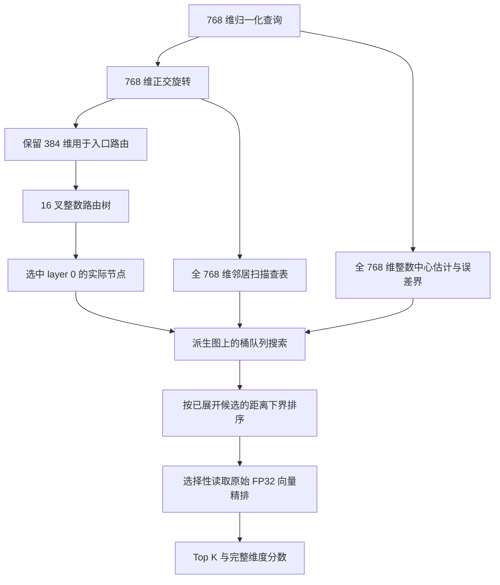

# 从入口路由到延迟精排：zvec 中 SymphonyQG 优化的算法原理

本文解释 `feat/quantized-graph-performance-improved` 分支中，以代码版本
`39c3d69a17a117eb46e758d999f2d619b43eef7d` 为基准的实现。目标场景是已有的、只读的
Cohere 768 维 FP32 cosine HNSW 快照。它将投影入口路由、图邻居批量量化扫描、整数中心估计和延迟
FP32 精排结合起来，在已有实验中取得了较好的速度与召回率折中。

后续实现已将核心 C++ 接口扩展到 1–4096 维 FP32 cosine / squared L2，并支持无路由模型的
量化图搜索。第 1–9 节保留上述 Cohere 基准及历史实验语境；当前通用接口与 L2 路径见第 10 节。

理解这套算法的关键，是区分三个问题：**从哪里开始搜索、接下来扩展谁、最后返回谁**。
它们对精度的要求不同，因此使用了不同的计算方式。384 维投影只用于第一个问题；图邻居编码覆盖完整
768 维；最终返回分数由原始完整 FP32 向量计算。

RaBitQ 提供了低比特向量表示和带理论误差分析的距离估计方法；SymphonyQG 将量化与图结构、邻居批量
扫描结合起来。本文讨论的是 zvec 中的具体改造，并非原论文的逐行复现。特别是，原 SymphonyQG
论文强调避免显式终端重排，而本实现保留了延迟的 FP32 精排。背景见
[RaBitQ 原论文](https://arxiv.org/abs/2405.12497)、
[SymphonyQG 原论文](https://arxiv.org/abs/2411.12229)及
[作者实现](https://github.com/gouyt13/SymphonyQG)。

## 1. 总体流程：把精度用在不同阶段

设数据库向量为 $x$，查询为 $q$，原始维数为 $D=768$，入口投影维数为 $p=384$，返回数量为
$K$。下文实验使用 $K=10$。cosine 路径沿用已有的归一化预处理；对单位向量，距离为

$$
d(q,x)=1-q^Tx=\frac{1}{2}\|q-x\|^2.
$$



这里的入口就是 **HNSW layer 0 节点**。路由树代替普通 HNSW 的上层下降过程；路由树自身的层级
不是 HNSW 的 layer。进入 layer 0 后，搜索使用从原图构造的量化邻接块。

| 阶段 | 表示与计算 | 承担的职责 |
| --- | --- | --- |
| 入口选择 | 旋转后 384 维，8 位整数中心打分 | 找到较好的起点 |
| 邻居导航 | 完整 768 维、节点中心化的 RaBitQ 编码 | 批量估计下一批值得访问的节点 |
| 展开节点估计 | 完整原始坐标中的移位 8 位量化 | 提供导航中心分数和精排下界 |
| 最终结果 | 原始完整 FP32 向量 | 确定返回分数及候选集内排序 |

因此，“用了 SQ8”不代表整个搜索换成了 SQ8 邻居距离；“用了 384 维”也不代表最终检索空间变成
384 维。

## 2. 离线准备：派生图和入口模型

打开快照时，程序从原 HNSW 的 layer 0 构造最大度数为 32 的派生图。短邻接行保留已有连接，并从
二跳候选中补边；较长的行进行多样性剪枝。这样既让邻居数适配批量扫描，又尽量保留导航所需的不同方向。

每个节点对应一个固定步长、对齐的内存块，包含中心量化信息、邻居 ID 和这些邻居相对于当前节点的
RaBitQ 编码。相邻数据一起读取，配合预取，减少遍历时的数据依赖和随机访问。代价是同一个向量可能
作为不同节点的邻居被重复编码，而且原始 FP32 向量仍然保留，不能据此声称总内存一定小于普通 HNSW。
派生 arena 在打开时重建，不写回原 HNSW 文件。

入口模型则是一棵预先训练的 16 叉聚类路由树。当前 Cohere 模型从数据库中选取 65,536 个锚点，使用
球面聚类递归划分，叶子保存实际图节点的内部 ID。训练不使用测试查询或 ground truth；全维聚类中心
经过旋转、投影和量化后写入 `router384.bin`，同时保存均值和树结构等信息。

这里的“模型”是检索入口路由器。初始精简实现只加载已有模型；后续增加了 C++ 离线工具
`quantized_graph_router`，可从对应快照完成训练、投影和模型写出，使用方法见
[模型生成说明](README.performance.md)。历史模型使用数据库样本估计均值，新工具的 `build` 模式
计算全库均值，`train` 模式则接受已有锚点和均值以固定迁移对照的输入。C++ 与 NumPy 的随机数和浮点
归约不同，不能要求新旧模型逐字节一致，必须重新验证召回率。
由于叶子保存的是图内部 ID，模型必须和对应快照配对；仅文档数量相同不足以证明兼容。

## 3. 为什么可以用一半维度选入口

### 3.1 旋转保留信息，截取坐标引入近似

Cohere 使用如下结构化正交变换：

$$
R=\frac{1}{\sqrt{768}}(H_{12}\otimes H_{64})S,
\qquad R^TR=I.
$$

$H_{12}$ 和 $H_{64}$ 是相应阶数的 Hadamard 矩阵，$S$ 是随机正负号对角矩阵。实现使用固定种子
`0x535147`，使模型和查询执行同一变换。768 维旋转本身无需补零；在实数算术下，它保持内积和距离。

令 $P_p$ 表示选取旋转后前 $p$ 个坐标。只保留 $P_pRx$ 才是降维步骤，会丢失信息。
其作用是降低路由树中大量中心打分的成本；查询仍然需要完成全维旋转，后续邻居扫描也使用全维表示。

### 3.2 路由打分不能漏掉均值项

设数据库均值为 $\mu$，某个路由中心为 $c$，定义残差

$$
r=q-\mu,\qquad s=c-\mu.
$$

则

$$
q^Tc=\mu^Tc+r^T\mu+r^Ts.
$$

对于固定查询，$r^T\mu$ 与候选中心无关，可以在排序时省略；$\mu^Tc$ 随中心变化，必须保留。
因此当前路由器估计的相似度是

$$
\widehat a(q,c)=\mu^Tc+
\frac{D}{p}\left\langle P_pRr,P_pRs\right\rangle_{\rm quant}.
$$

其中 $D/p=2$。代码以相似度的负数作为距离排序值。实现对查询投影做有符号 8 位量化，对中心投影做
无符号 8 位仿射量化。若重建值为 $\widehat r_i=a t_i$、$\widehat s_i=h u_i+b$，则

$$
\widehat r^T\widehat s
=a\left(h\sum_i t_i u_i+b\sum_i t_i\right).
$$

主要计算成为整数点积，可以用 AVX-512 VNNI 同时给一组 16 个中心打分。
当前路由 beam 为 1，沿选择出的分支下降并维护遇到的最佳叶子；它不保证找到所有锚点中的全局最优入口。

### 3.3 乘以二的数学依据和限度

对独立于随机符号 $S$ 的固定向量 $r,s$，先忽略量化和浮点误差。由于 Hadamard 元素绝对值相同，
每个原始坐标在所选 $p$ 行上的平方能量为 $p/D$；不同坐标的交叉项对独立随机符号取期望后为零。因此

$$
\mathbb E_S\left[
\frac{D}{p}\langle P_pRr,P_pRs\rangle
\right]=r^Ts.
$$

这是线性放大作为估计器的依据。它是对随机变换的期望结论，**不是固定种子下每个查询都准确的保证**，
也不包含实际 8 位量化误差。

更直接地，投影误差为

$$
e_{\rm proj}=r^T\left(\frac{D}{p}R^TP_p^TP_pR-I\right)s.
$$

当 $0<p<D$ 时，中间矩阵的特征值为 $D/p-1$ 和 $-1$，所以

$$
|e_{\rm proj}|\le
\max\left(\frac{D}{p}-1,1\right)\|r\|\|s\|.
$$

取一半维度只得到 $|e_{\rm proj}|\le\|r\|\|s\|$，最坏情形的界并不紧。因此，当前实现把这种近似
用于入口选择，并通过端到端召回率验证效果；它没有把投影分数当成可以安全剪掉最终结果的下界。

此外，这里的固定结构化旋转并非 Haar 均匀随机正交矩阵。RaBitQ 原论文的概率保证，需要逐项核对假设
后才能用于修改过的实现，不能直接推广到整条搜索流水线。

## 4. 全维整数中心估计：把误差变成可计算的下界

图搜索展开某个节点 $c$ 时，需要它与查询的距离。每次都读取 768 个 FP32 数会增加随机访问成本，
因此当前实现先用完整 768 维的移位量化中心计算估计值。

这一阶段的 $r=q-\mu$、$s=c-\mu$ 位于**原始完整坐标空间**，与上一节的投影路由区别开来。
设量化重建为 $\widehat r$、$\widehat s$。由

$$
q^Tc=q^T\mu+\mu^Tc-\|\mu\|^2+r^Ts
$$

得到 cosine 距离估计

$$
\widehat d(q,c)=1-
\left(q^T\mu+\mu^Tc-\|\mu\|^2+
\widehat r^T\widehat s\right).
$$

均值相关项使用完整向量计算：中心项预先存储，查询项每次查询计算一次。余下的残差内积使用整数指令。
在 768 维、查询码 $[-127,127]$、中心码 $[0,255]$ 的范围内，点积绝对值不超过
$768\times127\times255$，处于 int32 的表示范围内。

定义量化误差范数

$$
\epsilon_r=\|r-\widehat r\|,\qquad
\epsilon_s=\|s-\widehat s\|.
$$

分别展开内积误差，有

$$
\begin{aligned}
r^Ts-\widehat r^T\widehat s
&=(r-\widehat r)^Ts+\widehat r^T(s-\widehat s),\\
&=(r-\widehat r)^T\widehat s+r^T(s-\widehat s).
\end{aligned}
$$

应用 Cauchy–Schwarz 不等式，取两个有效上界的较小值：

$$
E_{\rm quant}=\min\left(
\epsilon_r\|s\|+\|\widehat r\|\epsilon_s,
\epsilon_s\|r\|+\|\widehat s\|\epsilon_r
\right).
$$

在实数算术下，这给出确定性结论

$$
|d(q,c)-\widehat d(q,c)|\le E_{\rm quant}.
$$

它直接使用本次查询和当前中心的实际重建误差，无需假设数据服从某种概率分布。以均值为中心可以在
数据聚集时缩小残差范数，从而有机会收紧上界；是否足够紧仍取决于数据和量化误差。

实现进一步给范数摘要留出向上舍入余量，并为均值运算、重建和完整 FP32 打分加入算术误差余量
$E_{\rm fp}$，构造

$$
L(q,c)=\operatorname{nextafter}
\left(\widehat d(q,c)-E_{\rm quant}-E_{\rm fp},-\infty\right).
$$

数学不等式与浮点实现的正确性需要分开看：上面的 Cauchy–Schwarz 推导是实数结论；实现中的下界还
依赖有限输入、无溢出，以及舍入余量覆盖实际算术路径。`nextafter` 本身不能代替完整误差分析。
已有边界测试和结果一致性测试提供了实现证据，但不等同于所有平台上的形式化证明。对应代码见
[整数中心估计器](../quantized_graph/quantized_graph_integer_center.h)。

## 5. 邻居扫描：为什么节点中心化与批量编码配合有效

对当前展开节点 $c$ 的邻居 $x$，有精确代数关系

$$
1-q^Tx=(1-q^Tc)-q^T(x-c).
$$

因此，同一邻接行中所有邻居共享中心距离，只需批量估计各自残差与查询的内积。
本实现调用 RaBitQ 的节点中心化邻居编码，将完整旋转空间中的残差信息压成低比特代码和修正因子。
查询准备阶段构造查找表，扫描时复用查询表，并更新当前节点的中心项。

具体地，查询表按每 4 个坐标的 16 种符号组合组织，邻居代码以 32 个一批打包，使用 FastScan 风格的
SIMD 查表计算。实际分数由编码保存的加法因子、缩放因子、查询查表和与中心距离组合而成。
这里的中心距离也可能是上一节的整数估计，所以邻居分数用于近似导航。

cosine 路径还要处理 L2 编码因子的转换。对归一化查询，

$$
1-q^Tx=\frac{1}{2}\left(\|q-x\|^2+1-\|x\|^2\right).
$$

代码将 L2 加法因子转换为
$\tfrac12(f_{\rm add,L2}+\|c\|^2-\|x\|^2)$，缩放因子乘以 $\tfrac12$，
再配合 cosine 中心距离使用。这些范数修正使不同度量下的中心项与邻居项一致，不能简单地把所有已有
分数统一乘一个常数。实现见 [SymphonyQG codec](../quantized_graph/symphony_qg_codec.h)。

## 6. 桶队列与停止条件：速度来自允许近似的搜索顺序

搜索前沿使用 2,048 个桶，桶宽为

$$
w=0.016\max(\widehat d(q,c_{\rm entry}),10^{-6}).
$$

正常范围内的估计距离按宽度 $w$ 分桶，用位图寻找最小非空桶，同一桶内按后进先出处理。与维护严格
有序堆相比，这减少了细粒度排序工作。普通桶中估计分数的差异小于桶宽，但负值桶和溢出桶不能套用
这个有限宽度结论；桶的位置也不是真实距离下界。

节点在展开时才标记为已访问。一个节点展开前可以从不同邻接行收到多个估计提案，已经展开的重复项
随后被跳过。当前桶结构没有把 `ef_search` 实现为硬性的候选容量，因此 `ef_search=800` 不能解释成
“最多展开 800 个节点”。

停止状态维护的是已展开、符合过滤条件的节点的**中心估计距离**。记其中第 $K$ 小的估计值为
$\widehat\tau_K$，前沿最小非空桶的左边界为 $b_{\rm next}$。已有至少 $K$ 个有效估计、且展开不少于
10 个节点后，满足以下任一条件即可停止：

$$
N_{\rm expanded}\ge64
\quad\text{或}\quad
b_{\rm next}-\widehat\tau_K
\ge0.02\max(\widehat\tau_K,10^{-6}).
$$

当前 patience 为 0，没有额外的连续停滞次数要求。队列耗尽或外部扫描预算达到上限也会停止。
由于前置条件要求足够多的有效估计，64 不是任何过滤条件、任何 $K$ 下都成立的无条件展开上限。

这属于启发式导航停止：桶边界、量化分数以及未探索图区域都不足以证明全库不存在更好结果。
它对召回率的影响必须通过实验衡量，不能借用精排下界来宣称全局安全。

## 7. 延迟 FP32 精排：候选集内可以证明什么

导航结束后，令 $\mathcal E$ 为已经展开且满足过滤条件的节点集合。将这些节点按 $L(q,c)$ 从小到大
排序，再选择性读取原始完整 FP32 向量，调用现有距离函数得到最终分数。

当已经取得 $K$ 个精排结果时，记当前第 $K$ 小的完整维度距离为 $\tau_K$。如果下一候选的下界满足

$$
L(q,c)>\tau_K,
$$

那么它以及后续下界更大的候选都不能改善当前 Top K，可以停止精排。这里使用严格大于，避免未经
处理就跳过与阈值相等的候选。实现按 4 个候选一批预取向量，以降低随机读取的等待。

这个结论的证明很直接：若每个下界均有效，则尚未精排节点满足
$d(q,c)\ge L(q,c)>\tau_K$，故不可能替换当前结果。**在下界有效、预算没有提前截断精排等条件下，
它保证已展开候选集内的 Top K；不保证全库 Top K。** 相同分数时的 ID 选择还取决于结果容器的并列处理。
本文所说的“精确打分”是已有的完整 FP32 距离函数，而非无限精度实数计算。

如果过滤等原因导致结果不足 $K$，实现还会尝试对已展开节点的未访问邻居做完整打分补足结果，并遵守
扫描预算。这一步也不意味着检索了所有尚未访问节点。

省略 SIMD 和资源管理细节后，查询逻辑可写为：

```text
prepare full-dimensional query tables and integer-query summaries
entry = projected_router(query, retained_dimensions=384)
frontier = {entry}
eligible_expanded = []

while frontier is not empty and budget permits:
    discard proposals for already expanded nodes
    if heuristic_navigation_stop(frontier, estimated_top_k): break
    c = pop candidate from the first nonempty bucket
    mark c expanded
    estimate, lower = full_dimensional_integer_center(query, c)
    if c is eligible:
        save (lower, c)
        update estimated_top_k with estimate
    batch-score full-dimensional RaBitQ neighbor blocks
    enqueue finite proposals for nodes not yet expanded

sort eligible_expanded by lower bound
for candidate in that order, with batched prefetch:
    if K exact scores exist and candidate.lower > exact_kth: break
    if budget exhausted: break
    score candidate using original full-dimensional FP32 vector
    update exact results

if fewer than K results and budget permits:
    exact-score eligible unvisited neighbors of expanded nodes
return results
```

导航停止使用 `estimated_top_k`，终端精排使用 `exact_kth`。这两个阈值的含义必须区分。

## 8. 成本模型：降维不等于 QPS 翻倍

将单次查询时间粗略拆开：

$$
T\approx T_{\rm prepare}+T_{\rm route}(p,h)
+N_e\bigl(T_{\rm center}(D)+T_{\rm scan}(D,m)\bigr)
+N_fT_{\rm FP32}(D)+T_{\rm queue}.
$$

其中 $h$ 是路由深度，$m\le32$ 是节点度数，$N_e$ 为展开节点数，$N_f$ 为完整精排次数。
路由中心打分大体随 $16hp$ 增长；将 $p$ 减半只减少这一部分，完整旋转、邻居扫描和 FP32 精排仍在。

相对于不使用路由的同一构建，只有减少的图展开和精排成本超过新增路由及相关开销，端到端 QPS 才会
提高。入口与全维路由的一致率只能解释入口行为，不能直接替代 Recall@10，也不能单独证明加速。

同样，下界越紧，通常越有机会减少 $N_f$；但计算更紧下界也有成本。有效优化要比较“额外估计时间”与
“省下的完整向量读取和打分时间”，而不是只比较公式中的误差大小。

## 9. Cohere 与 GIST：已观察到的收益及其边界

2026-10-27 的本地回测使用 Intel Xeon 6982P-C 环境，8 个物理核、16 个逻辑 CPU；进程允许使用
`0,2,4,6,8,10,12,14`，工作线程未分别绑核。Cohere 数据规模为 100 万个 768 维向量，cosine、
Top10、1,000 个查询，原始图参数为 `M=50, ef_construction=500`。下表是三轮配对计时的 QPS 中位数。

| Cohere 路径 | Recall@10 | 单线程 QPS | 8 线程合计 QPS |
| --- | ---: | ---: | ---: |
| 历史优化参考实现 | 90.42% | 35,336.87 | 257,118.77 |
| 当前精简实现 | 90.42% | 36,142.51 | 260,785.76 |

当前实现使用 `ef_search=800`。历史参考运行的参数标签是 20,000，但两者并非“各自展开这么多节点”；
实际工作量由桶导航和停止策略共同决定。这里是既有最优路径的精简回归比较，不是相对原版 HNSW 的
消融实验，也不能将约 2.28% / 1.43% 的差异宣称为新的算法突破。

单独质量校验的 10,000 条结果以及六次计时运行导出的共 60,000 条结果，ID 和十六进制 FP32 分数均
与相应参考一致。查询计时包括查询准备、路由、图搜索、精排和结果组装，不包括模型训练、打开与预构建、
网络服务或数据库 collection 层。每轮计时约 3 秒；这些是当前配置的观测值，不是长期线上吞吐保证。

GIST 使用 100 万个 960 维向量、L2 距离，同样测试 Top10 和 1,000 个查询。由于度量不同，入口打分
也必须改变。用同样的残差记号，去掉与中心无关的查询范数项后，应该估计

$$
\|c-\mu\|^2-
2\frac{D'}{p}
\left\langle P_pR(q-\mu),P_pR(c-\mu)\right\rangle_{\rm quant}.
$$

实验先把 960 维补零到 $D'=1024$，再旋转并保留 480、512 或 1024 维。中心范数保留完整值。
480 维代码在 SIMD 存储上补齐到 512 个槽位，查询尾部为零；这不等于做了原生 960 维正交变换再取
480 维。后者没有在这轮实验中验证。

| GIST 路径，约 90% 召回 | Recall@10 | 单线程 QPS | 8 线程合计 QPS |
| --- | ---: | ---: | ---: |
| 历史最佳 `final_gist`，无投影路由 | 90.04% | 8,424.90 | 66,300.23 |
| 路由实验构建，关闭路由 | 90.04% | 7,638.33 | 60,572.35 |
| 同一实验构建，保留 480 维路由 | 90.22% | 7,287.37 | 58,248.72 |
| 同一实验构建，保留 512 维路由 | 90.24% | 7,279.56 | 58,195.46 |

关闭路由的实验构建取前、后两组共六次运行的合并中位数，其余行各为三次。480 维相对同一构建关闭
路由，单线程下降约 4.59%，8 线程下降约 3.84%；这几组召回率接近但并非严格相等。
实验构建即使关闭路由也慢于历史最佳，因此不能把与历史版本的全部差距归因于降维路由。

这些历史结果说明：直接将 65,536 个锚点、半维投影的配置搬到 GIST，并没有显示稳定收益。
当时的精简分支只接受 768 维 cosine。后续通用实现已增加 L2 支持，允许独立调整锚点数、投影维度、
路由 beam 和搜索参数；接口支持不等于性能必然提高，仍需在同一构建下比较路由开关及不同配置。

上述参数探索和计时使用了同一批开发查询，尚非独立留出测试。若形成论文，还需用独立查询评估泛化，
并在相同构建、相同资源约束下分别消融投影、中心量化、下界精排与停止策略。

这些数字摘自本地 `~/bench/quantized_graph/performance_improved_20261027/` 的汇总及一致性记录。
原始结果、日志、二进制模型和数据保留在本地，不作为本文附件提交。

## 10. 实现入口与适用范围

| 内容 | 代码或说明 |
| --- | --- |
| 开启方式、平台要求和复现命令 | [使用说明](README.performance.md) |
| HNSW 优化路径适配 | [hnsw_quantized_graph.cc](hnsw_quantized_graph.cc) |
| 建块、搜索、停止和终端精排 | [quantized_graph.h](../quantized_graph/quantized_graph.h) |
| 投影路由加载与整数打分 | [quantized_graph_integer_router.h](../quantized_graph/quantized_graph_integer_router.h) |
| 完整维度中心估计与误差下界 | [quantized_graph_integer_center.h](../quantized_graph/quantized_graph_integer_center.h) |
| 桶队列 | [quantized_graph_bucket.h](../quantized_graph/quantized_graph_bucket.h) |
| 邻居编码适配 | [symphony_qg_codec.h](../quantized_graph/symphony_qg_codec.h) |
| 正交旋转 | [symphony_qg_rotator.h](../../../turbo/preprocessor/symphony_qg_rotator/symphony_qg_rotator.h) |
| 接口测试 | [quantized_graph_performance_test.cc](../../../../tests/core/interface/quantized_graph_performance_test.cc) |
| 基准驱动 | [quantized_graph_benchmark.cc](../../../../tools/core/quantized_graph_benchmark.cc) |

当前核心 C++ 接口支持 inline、非稀疏、未量化的 FP32 cosine / squared L2 快照，原始维数
为 1–4096，仍要求相应的 AVX-512/VNNI 能力。`use_quantized_graph=true` 启用量化图；可选的
`quantized_graph_model` 提供入口路由，非空模型也会隐式开启量化图。未启用两项时使用普通 HNSW。
启用量化图但不提供模型时，以数据库质心附近的节点为入口。此变更没有扩展 Python 或可变 collection
的配置接口；启用优化模式后拒绝插入，分组搜索走已有路径。

训练和加载均由 C++ 完成，新增模型格式记录原始维数、度量、旋转维数和 SIMD 存储步长；旧的 768 维
cosine / 384 维投影模型保持兼容。默认投影维数为原始维数的一半，可通过 `--projected` 调整。
GIST 的 960 维向量补零到 1024 维旋转，因此投影放大因子为 $1024/p$，即使 $p=480$ 也是如此。
cosine 使用归一化中心的球面聚类，L2 使用普通均值中心；两者均只读取数据库向量训练。

L2 路径将每个中心 $x$ 编码为 SQ8 重建向量 $\hat x$，保存实际重建误差的向上界
$\epsilon\geq\|x-\hat x\|_2$。若忽略浮点舍入，三角不等式给出

$$
\|q-x\|_2^2\geq
\left[\max\left(0,\sqrt{\|q-\hat x\|_2^2}-\epsilon\right)\right]^2.
$$

实现对距离求和及边界运算加入浮点舍入余量；该界用于有限、正常数值范围下的精排筛选。
当此下界已经大于当前第 $K$ 个精确距离时，可跳过该中心的原始 FP32 读取；否则计算完整距离。
邻居编码锚定在 $\hat x$ 上，因此邻居导航必须继续使用 $\|q-\hat x\|_2^2$，不能混入精排后的
$\|q-x\|_2^2$。最终结果保留完整 FP32 分数。下界保证的范围是已扩展候选，图遍历停止仍是启发式。

入口投影、路由 beam、桶宽、停止余量和展开上限现在可以独立配置。路由 beam 设为零可关闭选入口，
同时保留相同模型均值和图布局，便于消融实验。不存在由维数自动推导出的最优配置；建议用开发查询
筛选，冻结配置后用留出查询验证。详细构建命令和查询参数见[使用说明](README.performance.md)。

从理论贡献看，本文的均值分解、随机投影期望和 Cauchy–Schwarz 下界使用的是已有数学工具。
当前已形成的成果是这些组件在 zvec 中可回测的组合，以及对导航近似和候选精排保证的明确分工。
若进一步研究，值得检验的是：能否按查询不确定性自适应增加投影维数、在付出更少成本时收紧精排下界，
以及能否对图搜索停止建立额外可验证的条件。它们仍是待验证的问题，不能写成现有实现已经具备的保证。
